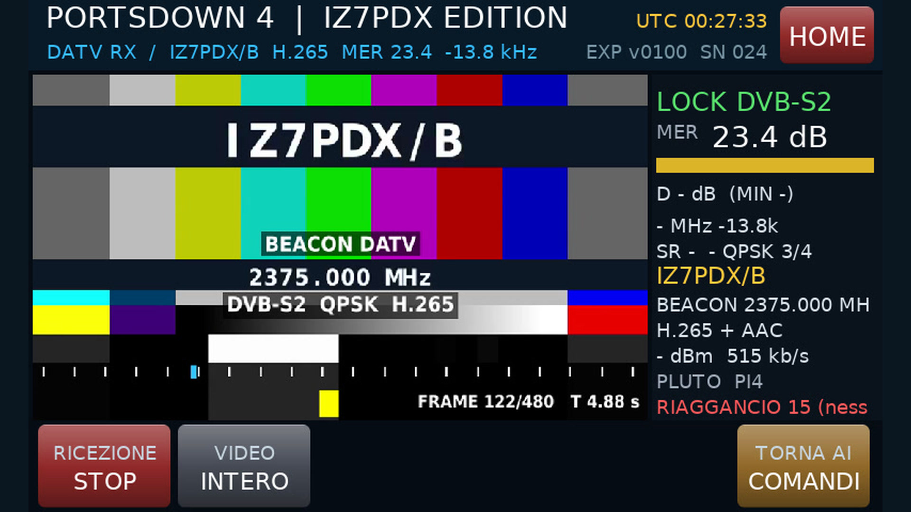
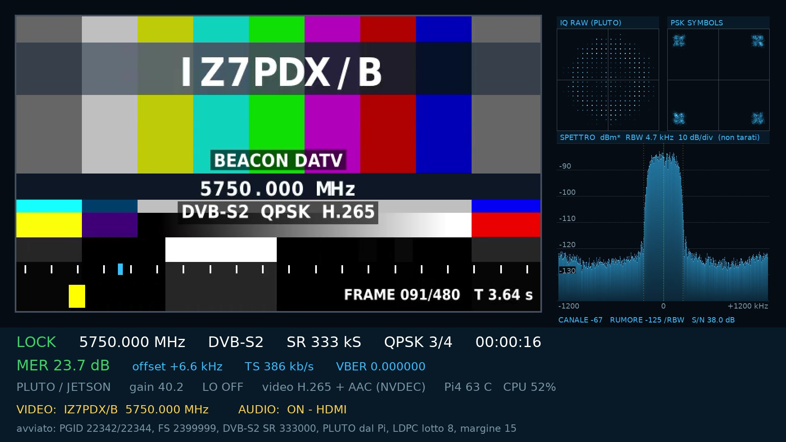
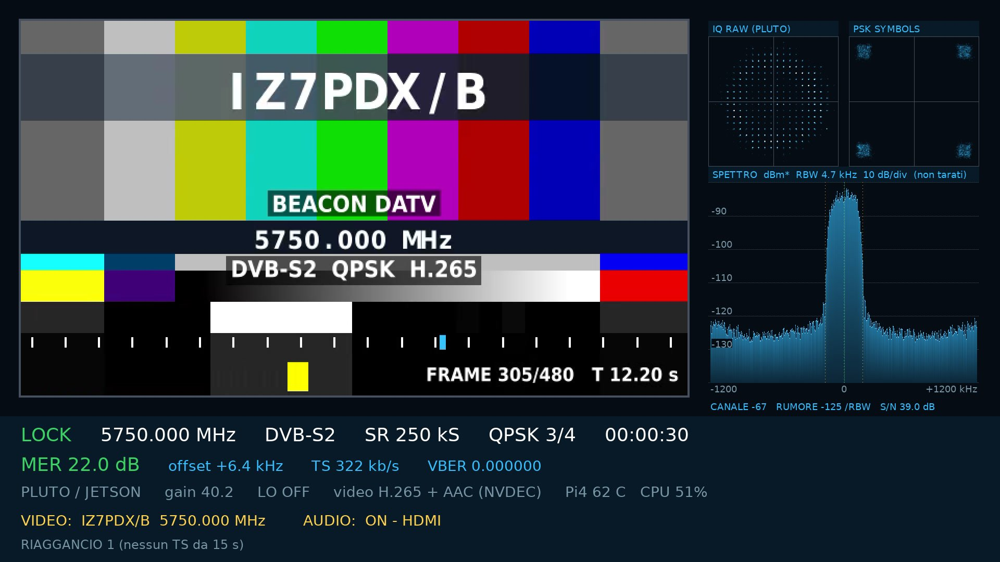
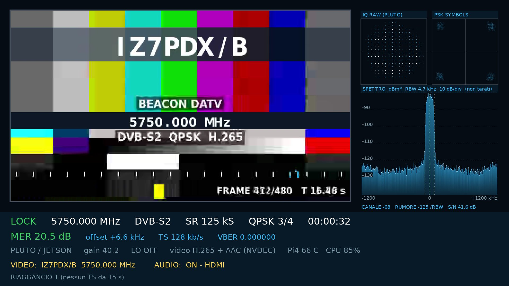
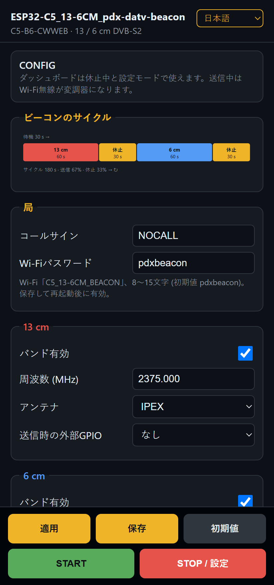

# ESP32-C5_13-6CM_pdx-datv-beacon

**A dual-band DVB-S2 DATV beacon (13 cm and 6 cm) on a single ESP32-C5, using the Wi-Fi transmitter as an I/Q modulator.**

**English** · [Italiano](README_it.md) · [Español](README_es.md) · [Deutsch](README_de.md) · [Português](README_pt.md) · [العربية](README_ar.md) · [日本語](README_ja.md) · [Русский](README_ru.md)

Dashboard in 12 languages · License GPL-3.0

<table><tr><th width="50%">13 cm — 2375.000 MHz</th><th width="50%">6 cm — 5750.000 MHz</th></tr>
<tr><td></td><td></td></tr></table>

*Neutral test card with callsign and frequency set from the dashboard, received with the Pd4Pdx (Pluto + leandvb): 13 cm on the 7" screen (MER 23.4 dB), 6 cm on the HDMI monitor (MER 22.8 dB, VBER 0). QPSK 3/4, 333 kS, H.265 + AAC.*

<p align="center"> </p>

*The ESP32-C5-Zero on the bench (blue LED = TX on 6 cm, wide-band antenna on IPEX) and the Pd4Pdx receiving it at 5750 MHz.*

<table><tr><th width="33%">333 kS</th><th width="33%">250 kS</th><th width="33%">125 kS</th></tr>
<tr><td></td><td></td><td></td></tr></table>

*6 cm at three symbol rates, received with the Pd4Pdx: 333 kS MER 23.7 dB, 250 kS MER 22.0 dB, 125 kS MER 20.5 dB, all with LOCK and VBER 0 (125 kS with the lighter test card for low symbol rates).*

## What it does

* Generates a **DVB-S2 QPSK 3/4** signal (normal frames, pilots) at **333 / 250 / 125 / 100 / 66 kS** (tested on reception: 333, 250 and 125 kS; 100 and 66 kS transmitted correctly but reception not yet verified; 500 kS in development), with the MPEG transport stream (H.265 video + AAC audio test card, SDT with your callsign) **built live on the chip**.
* Transmits alternately on **13 cm (2300–2450 MHz)** and **6 cm (5650–5850 MHz)** in a beacon cycle: TX 13 cm → pause → TX 6 cm → pause.
* Runs on a **Waveshare ESP32-C5-Zero** (ESP32-C5, single RISC-V core, 4 MB flash, no PSRAM). No external DAC, no FPGA.
* **Web dashboard** on its own access point (`C5_13-6CM_BEACON`, http://192.168.4.1) in 12 languages: callsign, frequencies, symbol rate, level, antenna per band (PCB or IPEX), GPIOs for external relays / PTT, cycle timing, **crystal correction in ppm** with a calculator.
* **Stop without buttons:** double power-up, a **STOP GPIO** to ground (switch, relay, remote control), or STOP from the dashboard.
* **CW carrier and Morse beacon** from the dashboard (**CW START**) or from the serial port (`CW ON`, `CW MORSE`), with the band's frequency, antenna, GPIOs and PTT; it stops at the maximum duration, with BOOT or with the STOP GPIO.
* **Crystal thermal compensation:** warming up from cold, the crystal drifts by up to −8 kHz on 6 cm. In CW / Morse the PLL follows the chip temperature every second (measured: from 8.6 kHz to 1.6 kHz peak-to-peak over 5 minutes); in DVB-S2 the PLL cannot change during a segment, so each segment starts already centred on the predicted drift (maximum error halved). On / off and reference temperature from the dashboard.

| Dashboard (phone) | | |
|---|---|---|
|  |  |  |

All languages: [DE](docs/img/dashboard_de.png) · [ES](docs/img/dashboard_es.png) · [FR](docs/img/dashboard_fr.png) · [PT](docs/img/dashboard_pt.png) · [NL](docs/img/dashboard_nl.png) · [PL](docs/img/dashboard_pl.png) · [EL](docs/img/dashboard_el.png) · [AR](docs/img/dashboard_ar.png) · [RU](docs/img/dashboard_ru.png) — full page: [EN](docs/img/dashboard_full_en.png) · [IT](docs/img/dashboard_full_it.png) · [JA](docs/img/dashboard_full_ja.png)

## How it works (short)

The ESP32-C5 radio has an internal sample-replay engine (used by Espressif for calibration). Its TX code is no longer in the vendor libraries, so the registers were found by experiment: two 40 MS/s sample banks played in ping-pong, refilled by the CPU with RRC-filtered QPSK while the other bank is on air, with an exact 333 000 S/s obtained by a fractional accumulator. BCH, LDPC, scrambling, PL framing and the transport-stream multiplexer all run on the single core in the gaps between bank swaps. Details and every measured number: **[docs/MEASUREMENTS.md](docs/MEASUREMENTS.md)**.

## Hardware

<p align="center"></p>

*ESP32-C5-Zero pinout (Waveshare board). This firmware uses GPIO26 (antenna switch), GPIO27 (WS2812 LED), GPIO28 (BOOT) and GPIO10 (STOP input); GPIO 0–10 and 23–25 can drive band relays and PTT.*

| Item | Notes |
|---|---|
| Board | Waveshare ESP32-C5-Zero (ESP32-C5HF4, 4 MB flash) |
| Antenna | on-board ceramic or **IPEX** (selected by GPIO26 from the dashboard); a wide-band antenna covering 2.4 and 5.7 GHz was used for the tests |
| GPIO | 26 antenna switch · 27 status LED (yellow = idle, red = TX 13 cm, blue = TX 6 cm) · 28 BOOT · **10 STOP** (input, to GND) · optional outputs 0–10, 23–25 for band relays and PTT |
| Power | USB-C |

The output level is a few milliwatts: an external filter and amplifier are needed for real use.

## Build and flash

**Easiest way: install from the browser** (Chrome or Edge on a computer, no ESP-IDF): **[web installer](https://photoluis.github.io/ESP32-C5_13-6CM_pdx-datv-beacon/install/)**. It writes the firmware and both test cards. To build it yourself:

Requires **ESP-IDF v6.1** (target `esp32c5`).

```
cd firmware
idf.py set-target esp32c5
idf.py build
esptool --chip esp32c5 --port COMx -b 921600 write-flash 0x2000 build/bootloader/bootloader.bin 0x8000 build/partition_table/partition-table.bin 0x10000 build/pdx_c5_probe.bin
```

The beacon also needs the neutral test card in flash at `0x290000` (one file for both bands, about 700 KB). It is generated on the PC with `tools/monoscope/make_es_c5.py` (ffmpeg with libx265 and the free DejaVu font); the callsign and the frequency are **not** in the file: the C5 overlays them from the dashboard settings.

```
cd tools/monoscope
python make_es_c5.py -o ../out/c5_mono_es_neutral.bin
esptool --chip esp32c5 --port COMx -b 921600 write-flash 0x290000 ../out/c5_mono_es_neutral.bin
```

**Low symbol rates:** below 333 kS the standard test card does not fit in the stream. Generate a lighter one for the lowest SR you will use (`--sr`) and write it at `0x340000`: below 333 kS the C5 picks it automatically, from 333 kS up it keeps the standard one at `0x290000` (better picture). With two cards, the one at `0x290000` must stay under 704 KB.

```
python make_es_c5.py --sr 125000 -o ../out/c5_mono_es_neutral_125000.bin
esptool --chip esp32c5 --port COMx -b 921600 write-flash 0x340000 ../out/c5_mono_es_neutral_125000.bin
```

**Personal test card:** instead of the bars you can use your own picture (`--image`, scaled to 640x360) or a short video (`--video`, repeated or cut to 19.2 s × `--loops`), with its own audio (`--audio`, otherwise a 1 kHz tone). The callsign strip is darkened to 50 % so the picture stays visible behind it; the frequency strip is solid. With a video, the strip area is frozen on the first frame. `--preview` composes the strips like the C5 and decodes the result for a check. The file goes to `0x290000` like the standard one (maximum 1.4 MB).

```
python make_es_c5.py --image my_card.jpg -o ../out/my_card.bin
python make_es_c5.py --video clip.mp4 --audio clip.mp4 --loops 1 -o ../out/my_clip.bin
python make_es_c5.py --image my_card.jpg --preview "IZ7PDX/B" "2375.000 MHz" -o ../out/my_card.bin
```

## First use

1. Power the board: it starts in **configuration** (no TX, steady yellow LED) because automatic start is off.
2. Connect the phone to Wi-Fi **`C5_13-6CM_BEACON`** (password `pdxbeacon`) and open **http://192.168.4.1**.
3. Set your callsign, frequencies, antenna and the crystal correction, press **Save**, then **START**.
4. During TX the Wi-Fi is the modulator, so the dashboard comes back in each pause.

### Stopping the beacon without buttons

* **Double power-up:** power on, remove power within 5 s and power on again → configuration, no TX.
* **STOP GPIO:** GPIO10 to GND stops the TX at once and reboots in configuration with Wi-Fi on; held low at power-up it prevents any TX.
* **Dashboard:** STOP / CONFIG during a pause.
* With buttons: BOOT always stops, even in TX.

## Status

First project phase completed (November 2026). Tested on air: DVB-S2 on 13 and 6 cm, live transport stream, beacon cycle, dashboard, STOP GPIO, crystal correction.

23 November 2026: CW / Morse from the dashboard and crystal thermal compensation, also tested on air; 125 kS received with picture (LOCK, MER 23.5 dB, VBER 0).

Next steps:
* reception tests at 100 and 66 kS; 500 kS;
* 1000 kS symbol rate;
* SPI link to an ESP32-S3 (dashboard during TX, cross-band transponder, streaming from a phone).

## Legal note

This is an **amateur-radio** project. Transmitting on 13 cm and 6 cm requires an amateur licence and must respect your national band plan and power limits. The Wi-Fi radio is used outside its normal channels and modulation: you are responsible for what you transmit.

## Licence and credits

GPL-3.0 — see [LICENSE](LICENSE). © 2026 Luigi D'Arcangelo, IZ7PDX.
Built on the DVB-S2 encoder and transport-stream code of the [ESP32-S3-CAM_PDX DATV Beacon](https://github.com/Photoluis/Esp32s3-cam-pdx-datv-beacon).
