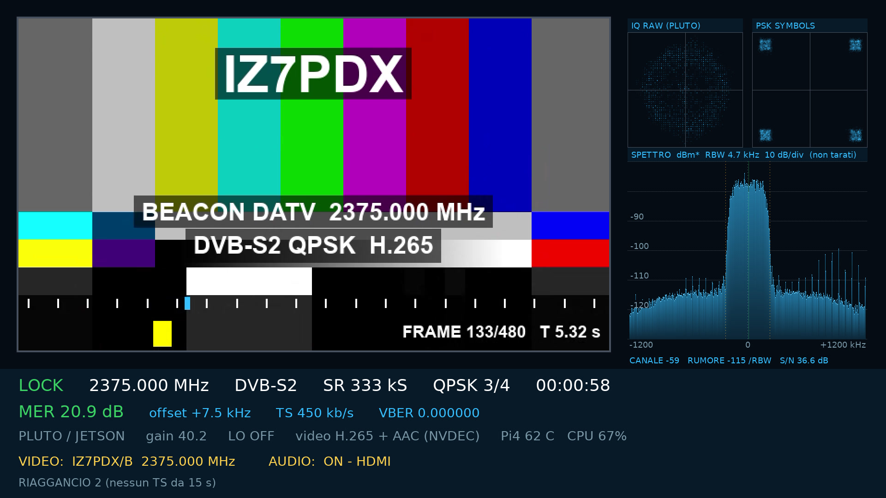

# ESP32-C5_13-6CM_pdx-datv-beacon

**A dual-band DVB-S2 DATV beacon (13 cm and 6 cm) on a single ESP32-C5, using the Wi-Fi transmitter as an I/Q modulator.**

[Italiano](README_it.md) · [日本語](README_ja.md) · Dashboard in 11 languages · License GPL-3.0

| 13 cm — 2375.000 MHz | 6 cm — 5750.000 MHz |
|---|---|
|  |  |

*Both bands received by a Pluto + leandvb station: QPSK 3/4, 333 kS, H.265 + AAC test card, MER ~21 dB, VBER 0.*

## What it does

* Generates a **DVB-S2 QPSK 3/4** signal (normal frames, pilots) at **125 / 250 / 333 / 500 kS**, with the MPEG transport stream (H.265 video + AAC audio test card, SDT with your callsign) **built live on the chip**.
* Transmits alternately on **13 cm (2300–2450 MHz)** and **6 cm (5650–5850 MHz)** in a beacon cycle: TX 13 cm → pause → TX 6 cm → pause.
* Runs on a **Waveshare ESP32-C5-Zero** (ESP32-C5, single RISC-V core, 4 MB flash, no PSRAM). No external DAC, no FPGA.
* **Web dashboard** on its own access point (`C5_13-6CM_BEACON`, http://192.168.4.1) in 11 languages: callsign, frequencies, symbol rate, level, antenna per band (PCB or IPEX), GPIOs for external relays / PTT, cycle timing, **crystal correction in ppm** with a calculator.
* **Stop without buttons:** double power-up, a **STOP GPIO** to ground (switch, relay, remote control), or STOP from the dashboard.

| Dashboard (phone) | | |
|---|---|---|
|  |  |  |

All languages: [DE](docs/img/dashboard_de.png) · [ES](docs/img/dashboard_es.png) · [FR](docs/img/dashboard_fr.png) · [PT](docs/img/dashboard_pt.png) · [NL](docs/img/dashboard_nl.png) · [PL](docs/img/dashboard_pl.png) · [EL](docs/img/dashboard_el.png) · [AR](docs/img/dashboard_ar.png) — full page: [EN](docs/img/dashboard_full_en.png) · [IT](docs/img/dashboard_full_it.png) · [JA](docs/img/dashboard_full_ja.png)

## How it works (short)

The ESP32-C5 radio has an internal sample-replay engine (used by Espressif for calibration). Its TX code is no longer in the vendor libraries, so the registers were found by experiment: two 40 MS/s sample banks played in ping-pong, refilled by the CPU with RRC-filtered QPSK while the other bank is on air, with an exact 333 000 S/s obtained by a fractional accumulator. BCH, LDPC, scrambling, PL framing and the transport-stream multiplexer all run on the single core in the gaps between bank swaps. Details and every measured number: **[docs/MEASUREMENTS.md](docs/MEASUREMENTS.md)**.

## Hardware

| Item | Notes |
|---|---|
| Board | Waveshare ESP32-C5-Zero (ESP32-C5HF4, 4 MB flash) |
| Antenna | on-board ceramic or **IPEX** (selected by GPIO26 from the dashboard); a wide-band antenna covering 2.4 and 5.7 GHz was used for the tests |
| GPIO | 26 antenna switch · 27 status LED (yellow = idle, red = TX 13 cm, blue = TX 6 cm) · 28 BOOT · **10 STOP** (input, to GND) · optional outputs 0–10, 23–25 for band relays and PTT |
| Power | USB-C |

The output level is a few milliwatts: an external filter and amplifier are needed for real use.

## Build and flash

Requires **ESP-IDF v6.1** (target `esp32c5`).

```
cd firmware
idf.py set-target esp32c5
idf.py build
esptool --chip esp32c5 --port COMx -b 921600 write-flash 0x2000 build/bootloader/bootloader.bin 0x8000 build/partition_table/partition-table.bin 0x10000 build/pdx_c5_probe.bin
```

The beacon also needs the two pre-encoded test cards in flash (6 cm at `0x290000`, 13 cm at `0x320000`). **Neutral test cards and a ready-to-flash image will be published with the first release**; they are generated with the `make_es` tool of the [ESP32-S3-CAM_PDX DATV Beacon](https://github.com/Photoluis/Esp32s3-cam-pdx-datv-beacon) project.

## First use

1. Power the board: it starts in **configuration** (no TX, steady yellow LED) because automatic start is off.
2. Connect the phone to Wi-Fi **`C5_13-6CM_BEACON`** (password `pdxbeacon`) and open **http://192.168.4.1**.
3. Set your callsign, frequencies, antenna and the crystal correction, press **Save**, then **START**.
4. During TX the Wi-Fi is the modulator, so the dashboard comes back in each pause.

### Stopping the beacon without buttons

* **Double power-up:** power on, remove power within 5 s and power on again → configuration, no TX.
* **STOP GPIO:** GPIO10 to GND stops the TX at once and reboots in configuration with Wi-Fi on; held low at power-up it prevents any TX.
* **Dashboard:** STOP / CONFIG during a pause.
* With buttons: BOOT always stops, even in TX.

## Status

First project phase completed (November 2026). Tested on air: DVB-S2 on 13 and 6 cm, live transport stream, beacon cycle, dashboard, STOP GPIO, crystal correction.

Next steps:
* temperature compensation of the crystal drift during TX (~1.6 ppm/min from cold);
* test card with the callsign overlaid from the dashboard;
* 1000 kS symbol rate;
* SPI link to an ESP32-S3 (dashboard during TX, cross-band transponder, streaming from a phone).

## Legal note

This is an **amateur-radio** project. Transmitting on 13 cm and 6 cm requires an amateur licence and must respect your national band plan and power limits. The Wi-Fi radio is used outside its normal channels and modulation: you are responsible for what you transmit.

## Licence and credits

GPL-3.0 — see [LICENSE](LICENSE). © 2026 Luigi D'Arcangelo, IZ7PDX.
Built on the DVB-S2 encoder and transport-stream code of the [ESP32-S3-CAM_PDX DATV Beacon](https://github.com/Photoluis/Esp32s3-cam-pdx-datv-beacon). Developed with the help of Claude (Anthropic).
