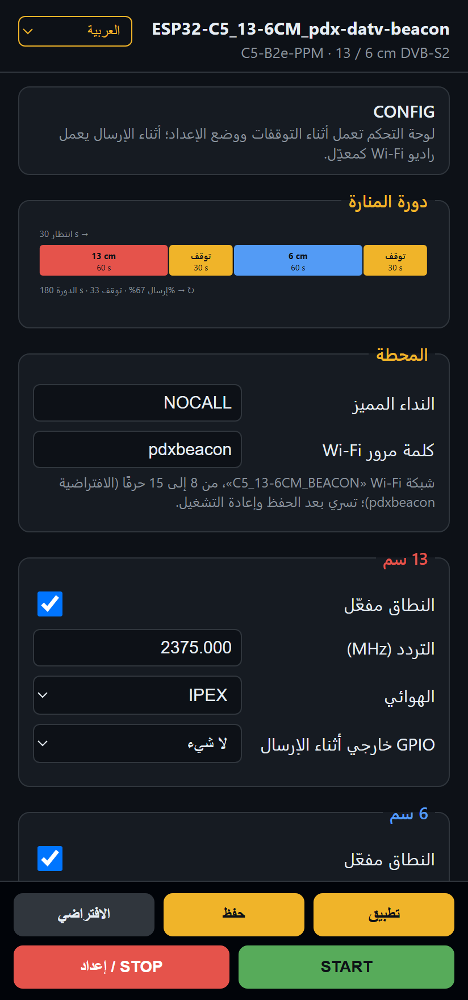

# ESP32-C5_13-6CM_pdx-datv-beacon

<div dir="rtl">

**منارة DATV بنظام DVB-S2 ثنائية النطاق (13 سم و6 سم) على شريحة ESP32-C5 واحدة، تستخدم مُرسِل Wi-Fi كمعدِّل I/Q.**

[English](README.md) · [Italiano](README_it.md) · [Español](README_es.md) · [Deutsch](README_de.md) · [Português](README_pt.md) · **العربية** · [日本語](README_ja.md)

لوحة التحكم بـ 11 لغة · الترخيص GPL-3.0

| 13 سم — 2375.000 MHz | 6 سم — 5750.000 MHz |
|---|---|
|  |  |

*النطاقان كما استقبلهما جهاز Pd4Pdx ‏(Pluto + leandvb): ‏QPSK 3/4، ‏333 kS، صورة اختبار H.265 + AAC، ‏MER نحو 21 dB، ‏VBER 0.*

## ماذا تفعل

* تولّد إشارة **DVB-S2 QPSK 3/4** (إطارات عادية مع إشارات مرشدة) بمعدلات **125 / 250 / 333 / 500 kS**، مع تيار نقل MPEG (صورة اختبار بفيديو H.265 وصوت AAC، وجدول SDT يحمل نداءك المميز) **يُبنى لحظيًا على الشريحة نفسها**.
* ترسل بالتناوب على **13 سم (2300–2450 MHz)** و**6 سم (5650–5850 MHz)** في دورة منارة: إرسال 13 سم ← توقف ← إرسال 6 سم ← توقف.
* تعمل على لوحة **Waveshare ESP32-C5-Zero** ‏(ESP32-C5، نواة RISC-V واحدة، ذاكرة فلاش 4 MB، دون PSRAM). لا حاجة إلى DAC خارجي ولا إلى FPGA.
* **لوحة تحكم ويب** عبر نقطة اتصال خاصة بها (`C5_13-6CM_BEACON`، ‏http://192.168.4.1) بـ 11 لغة: النداء المميز، الترددات، معدل الرموز، المستوى، الهوائي لكل نطاق (PCB أو IPEX)، منافذ GPIO للمرحّلات الخارجية وPTT، أزمنة الدورة، و**تصحيح البلورة بوحدة ppm** مع حاسبة.
* **إيقاف دون أزرار:** تشغيل مزدوج، أو توصيل **GPIO الإيقاف** بالأرضي (مفتاح، مرحّل، تحكم عن بُعد)، أو STOP من لوحة التحكم.

| لوحة التحكم (هاتف) | | |
|---|---|---|
|  |  |  |

كل اللغات: [IT](docs/img/dashboard_it.png) · [DE](docs/img/dashboard_de.png) · [FR](docs/img/dashboard_fr.png) · [PT](docs/img/dashboard_pt.png) · [NL](docs/img/dashboard_nl.png) · [PL](docs/img/dashboard_pl.png) · [EL](docs/img/dashboard_el.png) · [JA](docs/img/dashboard_ja.png)

## كيف تعمل (باختصار)

يحتوي راديو ESP32-C5 على محرك داخلي لإعادة تشغيل العينات (تستخدمه Espressif في المعايرة). لم يعد كود الإرسال الخاص به موجودًا في مكتبات الشركة، لذلك اكتُشفت السجلات بالتجربة: بنكان من العينات بمعدل 40 MS/s يُشغَّلان بالتناوب، وتملأ المعالجة البنك الحر بإشارة QPSK مرشّحة RRC بينما يكون الآخر على الهواء، ويتحقق معدل 333 000 S/s بدقة بفضل مُراكِم كسري. تعمل BCH وLDPC والخلط وإطار PL ومجمّع تيار النقل كلها على النواة الوحيدة في الفترات بين تبديل البنوك. التفاصيل وكل القيم المقيسة: **[docs/MEASUREMENTS.md](docs/MEASUREMENTS.md)** (بالإنجليزية).

## العتاد

| العنصر | ملاحظات |
|---|---|
| اللوحة | Waveshare ESP32-C5-Zero ‏(ESP32-C5HF4، فلاش 4 MB) |
| الهوائي | خزفي على اللوحة أو **IPEX** (يُختار عبر GPIO26 من لوحة التحكم)؛ استُخدم في الاختبارات هوائي عريض النطاق لـ 2.4 و5.7 GHz |
| GPIO | ‏26 مبدّل الهوائي · 27 مؤشر الحالة (أصفر = انتظار، أحمر = إرسال 13 سم، أزرق = إرسال 6 سم) · 28 BOOT · **10 الإيقاف** (مدخل، إلى GND) · مخارج اختيارية 0–10 و23–25 لمرحّلات النطاق وPTT |
| التغذية | USB-C |

مستوى الخرج بضعة ملّي واط: يلزم مرشّح ومضخّم خارجيان للاستخدام الفعلي.

## البناء والتحميل

يتطلب **ESP-IDF v6.1** (الهدف `esp32c5`).

</div>

```
cd firmware
idf.py set-target esp32c5
idf.py build
esptool --chip esp32c5 --port COMx -b 921600 write-flash 0x2000 build/bootloader/bootloader.bin 0x8000 build/partition_table/partition-table.bin 0x10000 build/pdx_c5_probe.bin
```

<div dir="rtl">

تحتاج المنارة أيضًا إلى صورتَي الاختبار المرمّزتين مسبقًا في الفلاش (6 سم عند `0x290000`، و13 سم عند `0x320000`). **ستُنشر صور الاختبار المحايدة وصورة جاهزة للتحميل مع الإصدار الأول**؛ وتُولَّد بأداة `make_es` من مشروع [ESP32-S3-CAM_PDX DATV Beacon](https://github.com/Photoluis/Esp32s3-cam-pdx-datv-beacon).

## الاستخدام الأول

1. وصّل التغذية: تبدأ اللوحة في **وضع الإعداد** (بلا إرسال، مؤشر أصفر ثابت) لأن البدء التلقائي معطّل.
2. صِل الهاتف بشبكة **`C5_13-6CM_BEACON`** (كلمة المرور `pdxbeacon`) وافتح **http://192.168.4.1**.
3. اضبط النداء المميز والترددات والهوائي وتصحيح البلورة، ثم اضغط **حفظ** ثم **START**.
4. أثناء الإرسال يعمل Wi-Fi كمعدِّل: تعود لوحة التحكم في كل توقف.

### إيقاف المنارة دون أزرار

* **تشغيل مزدوج:** شغّل، افصل التغذية خلال 5 ثوانٍ ثم شغّل مجددًا ← وضع الإعداد، بلا إرسال.
* **GPIO الإيقاف:** توصيل GPIO10 بـ GND يوقف الإرسال فورًا ويعيد التشغيل في وضع الإعداد مع Wi-Fi؛ وإذا كان موصولًا عند التشغيل يمنع أي إرسال.
* **لوحة التحكم:** ‏STOP / إعداد أثناء التوقف.
* بالأزرار: BOOT يوقف دائمًا حتى أثناء الإرسال.

## الحالة

اكتملت المرحلة الأولى من المشروع (نوفمبر 2026). جُرِّب على الهواء: DVB-S2 على 13 و6 سم، تيار نقل لحظي، دورة المنارة، لوحة التحكم، GPIO الإيقاف، تصحيح البلورة.

الخطوات التالية:
* تعويض حراري لانحراف البلورة أثناء الإرسال (نحو 1.6 ppm في الدقيقة عند البدء باردًا)؛
* صورة اختبار يظهر عليها النداء المميز المُدخل من لوحة التحكم؛
* معدل رموز 1000 kS؛
* وصلة SPI مع ESP32-S3 (لوحة تحكم أثناء الإرسال، مُرحِّل بين النطاقات، بث من الهاتف).

## ملاحظة قانونية

هذا مشروع **هواة راديو**. الإرسال على 13 سم و6 سم يتطلب ترخيص هواة راديو واحترام خطة النطاقات وحدود القدرة في بلدك. يُستخدم راديو Wi-Fi خارج قنواته وتعديله المعتادين: أنت مسؤول عمّا ترسله.

## الترخيص والشكر

GPL-3.0 — راجع [LICENSE](LICENSE). © 2026 Luigi D'Arcangelo, IZ7PDX.
مبني على مرمّز DVB-S2 وتيار النقل من مشروع [ESP32-S3-CAM_PDX DATV Beacon](https://github.com/Photoluis/Esp32s3-cam-pdx-datv-beacon).

</div>
