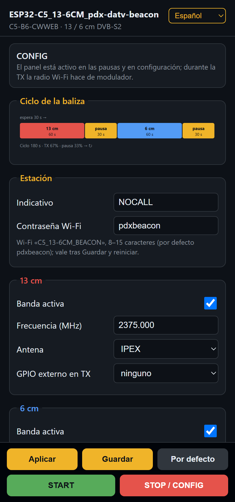
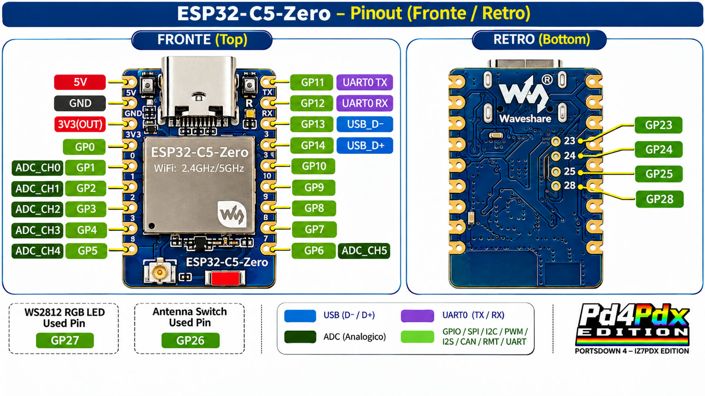

# ESP32-C5_13-6CM_pdx-datv-beacon

<div dir="rtl">

**منارة DATV بنظام DVB-S2 ثنائية النطاق (13 سم و6 سم) على شريحة ESP32-C5 واحدة، تستخدم مُرسِل Wi-Fi كمعدِّل I/Q.**

[English](README.md) · [Italiano](README_it.md) · [Español](README_es.md) · [Deutsch](README_de.md) · [Português](README_pt.md) · **العربية** · [日本語](README_ja.md) · [Русский](README_ru.md)

لوحة التحكم بـ 12 لغة · الترخيص GPL-3.0

<table><tr><th width="50%">13 سم — 2375.000 MHz</th><th width="50%">6 سم — 5750.000 MHz</th></tr>
<tr><td></td><td></td></tr></table>

*صورة اختبار محايدة يظهر عليها النداء المميز والتردد المضبوطان من لوحة التحكم، استُقبلت بجهاز Pd4Pdx ‏(Pluto + leandvb): ‏13 سم على شاشة 7 بوصات (MER 23.4 dB)، و6 سم على شاشة HDMI ‏(MER 22.8 dB، ‏VBER 0). ‏QPSK 3/4، ‏333 kS، ‏H.265 + AAC.*

<p align="center"> </p>

*لوحة ESP32-C5-Zero على منصة الاختبار (المؤشر الأزرق = إرسال على 6 سم، هوائي عريض النطاق على IPEX) وجهاز Pd4Pdx يستقبلها على 5750 MHz.*

## ماذا تفعل

* تولّد إشارة **DVB-S2 QPSK 3/4** (إطارات عادية مع إشارات مرشدة) بمعدل **333 kS** (‏125 / 250 / 500 kS قيد التطوير)، مع تيار نقل MPEG (صورة اختبار بفيديو H.265 وصوت AAC، وجدول SDT يحمل نداءك المميز) **يُبنى لحظيًا على الشريحة نفسها**.
* ترسل بالتناوب على **13 سم (2300–2450 MHz)** و**6 سم (5650–5850 MHz)** في دورة منارة: إرسال 13 سم ← توقف ← إرسال 6 سم ← توقف.
* تعمل على لوحة **Waveshare ESP32-C5-Zero** ‏(ESP32-C5، نواة RISC-V واحدة، ذاكرة فلاش 4 MB، دون PSRAM). لا حاجة إلى DAC خارجي ولا إلى FPGA.
* **لوحة تحكم ويب** عبر نقطة اتصال خاصة بها (`C5_13-6CM_BEACON`، ‏http://192.168.4.1) بـ 12 لغة: النداء المميز، الترددات، معدل الرموز، المستوى، الهوائي لكل نطاق (PCB أو IPEX)، منافذ GPIO للمرحّلات الخارجية وPTT، أزمنة الدورة، و**تصحيح البلورة بوحدة ppm** مع حاسبة.
* **إيقاف دون أزرار:** تشغيل مزدوج، أو توصيل **GPIO الإيقاف** بالأرضي (مفتاح، مرحّل، تحكم عن بُعد)، أو STOP من لوحة التحكم.
* **حامل CW ومنارة مورس** من لوحة التحكم (**CW START**) أو عبر المنفذ التسلسلي (`CW ON`، `CW MORSE`)، بتردد النطاق وهوائيه ومنافذ GPIO وPTT الخاصة به؛ يتوقف عند انتهاء المدة القصوى أو بالزر BOOT أو بـ GPIO الإيقاف.
* **التعويض الحراري للبلورة:** عند التسخين من البرودة تنحرف البلورة حتى −8 kHz على 6 سم. في CW / مورس يتبع الـ PLL درجة حرارة الشريحة كل ثانية (القياس: من 8.6 kHz إلى 1.6 kHz من القمة إلى القمة خلال 5 دقائق)؛ وفي DVB-S2 لا يمكن تغيير الـ PLL أثناء المقطع، لذلك يبدأ كل مقطع متمركزًا مسبقًا على الانحراف المتوقع (يُخفَّض الخطأ الأقصى إلى النصف). التفعيل ودرجة الحرارة المرجعية من لوحة التحكم.

| لوحة التحكم (هاتف) | | |
|---|---|---|
|  |  |  |

كل اللغات: [IT](docs/img/dashboard_it.png) · [DE](docs/img/dashboard_de.png) · [FR](docs/img/dashboard_fr.png) · [PT](docs/img/dashboard_pt.png) · [NL](docs/img/dashboard_nl.png) · [PL](docs/img/dashboard_pl.png) · [EL](docs/img/dashboard_el.png) · [RU](docs/img/dashboard_ru.png) · [JA](docs/img/dashboard_ja.png)

## كيف تعمل (باختصار)

يحتوي راديو ESP32-C5 على محرك داخلي لإعادة تشغيل العينات (تستخدمه Espressif في المعايرة). لم يعد كود الإرسال الخاص به موجودًا في مكتبات الشركة، لذلك اكتُشفت السجلات بالتجربة: بنكان من العينات بمعدل 40 MS/s يُشغَّلان بالتناوب، وتملأ المعالجة البنك الحر بإشارة QPSK مرشّحة RRC بينما يكون الآخر على الهواء، ويتحقق معدل 333 000 S/s بدقة بفضل مُراكِم كسري. تعمل BCH وLDPC والخلط وإطار PL ومجمّع تيار النقل كلها على النواة الوحيدة في الفترات بين تبديل البنوك. التفاصيل وكل القيم المقيسة: **[docs/MEASUREMENTS.md](docs/MEASUREMENTS.md)** (بالإنجليزية).

## العتاد

<p align="center"></p>

*منافذ لوحة ESP32-C5-Zero (لوحة Waveshare). يستخدم هذا البرنامج GPIO26 (مبدّل الهوائي) وGPIO27 (مؤشر WS2812) وGPIO28 (BOOT) وGPIO10 (مدخل الإيقاف)؛ ويمكن لمنافذ GPIO 0–10 و23–25 تشغيل مرحّلات النطاق وPTT.*

| العنصر | ملاحظات |
|---|---|
| اللوحة | Waveshare ESP32-C5-Zero ‏(ESP32-C5HF4، فلاش 4 MB) |
| الهوائي | خزفي على اللوحة أو **IPEX** (يُختار عبر GPIO26 من لوحة التحكم)؛ استُخدم في الاختبارات هوائي عريض النطاق لـ 2.4 و5.7 GHz |
| GPIO | ‏26 مبدّل الهوائي · 27 مؤشر الحالة (أصفر = انتظار، أحمر = إرسال 13 سم، أزرق = إرسال 6 سم) · 28 BOOT · **10 الإيقاف** (مدخل، إلى GND) · مخارج اختيارية 0–10 و23–25 لمرحّلات النطاق وPTT |
| التغذية | USB-C |

مستوى الخرج بضعة ملّي واط: يلزم مرشّح ومضخّم خارجيان للاستخدام الفعلي.

## البناء والتحميل

يتطلب **ESP-IDF v6.1** (الهدف `esp32c5`).

</div>

```
cd firmware
idf.py set-target esp32c5
idf.py build
esptool --chip esp32c5 --port COMx -b 921600 write-flash 0x2000 build/bootloader/bootloader.bin 0x8000 build/partition_table/partition-table.bin 0x10000 build/pdx_c5_probe.bin
```

<div dir="rtl">

تحتاج المنارة أيضًا إلى صورة الاختبار المحايدة في الفلاش عند `0x290000` (ملف واحد للنطاقين، نحو 700 KB). تُولَّد على الحاسوب بالأداة `tools/monoscope/make_es_c5.py` (ffmpeg مع libx265 والخط المجاني DejaVu)؛ النداء المميز والتردد **ليسا** في الملف: تضيفهما C5 فوق الصورة من إعدادات لوحة التحكم.

</div>

```
cd tools/monoscope
python make_es_c5.py -o ../out/c5_mono_es_neutral.bin
esptool --chip esp32c5 --port COMx -b 921600 write-flash 0x290000 ../out/c5_mono_es_neutral.bin
```

**صورة اختبار شخصية:** بدلاً من الأشرطة يمكن استخدام صورة خاصة (`--image`، تُضبط على 640x360) أو مقطع فيديو قصير (`--video`، يُكرَّر أو يُقص إلى 19.2 ث × `--loops`) مع صوته (`--audio`، وإلا فنغمة 1 kHz). يُعتَّم شريط النداء المميز بنسبة 50 % لتبقى الصورة ظاهرة خلفه، أما شريط التردد فمُعتم بالكامل. مع الفيديو تبقى منطقة الأشرطة ثابتة على الإطار الأول. يركّب `--preview` الأشرطة كما تفعل C5 ويفك ترميز النتيجة للتحقق. يُكتب الملف في `0x290000` مثل الملف القياسي (1.4 MB كحد أقصى).

```
python make_es_c5.py --image my_card.jpg -o ../out/my_card.bin
python make_es_c5.py --video clip.mp4 --audio clip.mp4 --loops 1 -o ../out/my_clip.bin
python make_es_c5.py --image my_card.jpg --preview "IZ7PDX/B" "2375.000 MHz" -o ../out/my_card.bin
```

<div dir="rtl">

## الاستخدام الأول

1. وصّل التغذية: تبدأ اللوحة في **وضع الإعداد** (بلا إرسال، مؤشر أصفر ثابت) لأن البدء التلقائي معطّل.
2. صِل الهاتف بشبكة **`C5_13-6CM_BEACON`** (كلمة المرور `pdxbeacon`) وافتح **http://192.168.4.1**.
3. اضبط النداء المميز والترددات والهوائي وتصحيح البلورة، ثم اضغط **حفظ** ثم **START**.
4. أثناء الإرسال يعمل Wi-Fi كمعدِّل: تعود لوحة التحكم في كل توقف.

### إيقاف المنارة دون أزرار

* **تشغيل مزدوج:** شغّل، افصل التغذية خلال 5 ثوانٍ ثم شغّل مجددًا ← وضع الإعداد، بلا إرسال.
* **GPIO الإيقاف:** توصيل GPIO10 بـ GND يوقف الإرسال فورًا ويعيد التشغيل في وضع الإعداد مع Wi-Fi؛ وإذا كان موصولًا عند التشغيل يمنع أي إرسال.
* **لوحة التحكم:** ‏STOP / إعداد أثناء التوقف.
* بالأزرار: BOOT يوقف دائمًا حتى أثناء الإرسال.

## الحالة

اكتملت المرحلة الأولى من المشروع (نوفمبر 2026). جُرِّب على الهواء: DVB-S2 على 13 و6 سم، تيار نقل لحظي، دورة المنارة، لوحة التحكم، GPIO الإيقاف، تصحيح البلورة.

23 نوفمبر 2026: CW / مورس من لوحة التحكم والتعويض الحراري للبلورة، جُرِّبا على الهواء أيضًا.

الخطوات التالية:
* معدلات رموز غير 333 kS ‏(125 / 250 / 500 kS وما دون 125 kS)؛
* معدل رموز 1000 kS؛
* وصلة SPI مع ESP32-S3 (لوحة تحكم أثناء الإرسال، مُرحِّل بين النطاقات، بث من الهاتف).

## ملاحظة قانونية

هذا مشروع **هواة راديو**. الإرسال على 13 سم و6 سم يتطلب ترخيص هواة راديو واحترام خطة النطاقات وحدود القدرة في بلدك. يُستخدم راديو Wi-Fi خارج قنواته وتعديله المعتادين: أنت مسؤول عمّا ترسله.

## الترخيص والشكر

GPL-3.0 — راجع [LICENSE](LICENSE). © 2026 Luigi D'Arcangelo, IZ7PDX.
مبني على مرمّز DVB-S2 وتيار النقل من مشروع [ESP32-S3-CAM_PDX DATV Beacon](https://github.com/Photoluis/Esp32s3-cam-pdx-datv-beacon).

</div>
