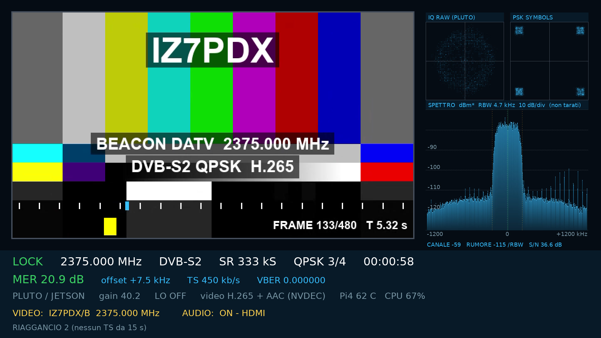
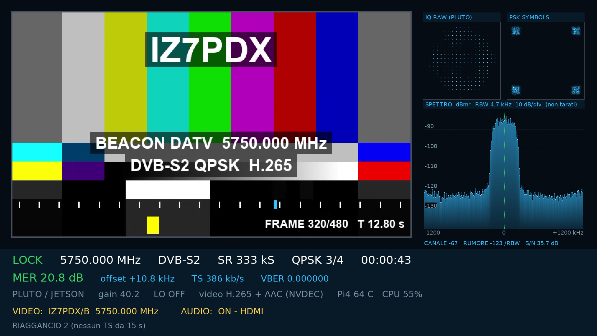
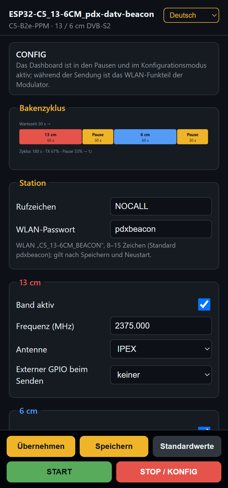

# ESP32-C5_13-6CM_pdx-datv-beacon

**DVB-S2-DATV-Bake für zwei Bänder (13 cm und 6 cm) auf einem einzigen ESP32-C5, der den WLAN-Sender als I/Q-Modulator nutzt.**

[English](README.md) · [Italiano](README_it.md) · [Español](README_es.md) · **Deutsch** · [Português](README_pt.md) · [العربية](README_ar.md) · [日本語](README_ja.md)

Dashboard in 11 Sprachen · Lizenz GPL-3.0

| 13 cm — 2375,000 MHz | 6 cm — 5750,000 MHz |
|---|---|
|  |  |

*Beide Bänder empfangen mit dem Pd4Pdx (Pluto + leandvb): QPSK 3/4, 333 kS, Testbild H.265 + AAC, MER ~21 dB, VBER 0.*

## Was sie kann

* Erzeugt ein **DVB-S2-Signal QPSK 3/4** (Normal-Frames, Piloten) mit **125 / 250 / 333 / 500 kS**; der MPEG-Transportstrom (Testbild in H.265 + AAC-Ton, SDT mit deinem Rufzeichen) wird **in Echtzeit auf dem Chip erzeugt**.
* Sendet im Bakenzyklus abwechselnd auf **13 cm (2300–2450 MHz)** und **6 cm (5650–5850 MHz)**: TX 13 cm → Pause → TX 6 cm → Pause.
* Läuft auf einem **Waveshare ESP32-C5-Zero** (ESP32-C5, ein RISC-V-Kern, 4 MB Flash, kein PSRAM). Kein externer DAC, kein FPGA.
* **Web-Dashboard** über einen eigenen Access Point (`C5_13-6CM_BEACON`, http://192.168.4.1) in 11 Sprachen: Rufzeichen, Frequenzen, Symbolrate, Pegel, Antenne pro Band (PCB oder IPEX), GPIOs für externe Relais / PTT, Zykluszeiten, **Quarzkorrektur in ppm** mit Rechner.
* **Stopp ohne Tasten:** doppeltes Einschalten, ein **STOP-GPIO** gegen Masse (Schalter, Relais, Fernsteuerung) oder STOP im Dashboard.

| Dashboard (Smartphone) | | |
|---|---|---|
|  |  |  |

Alle Sprachen: [ES](docs/img/dashboard_es.png) · [FR](docs/img/dashboard_fr.png) · [PT](docs/img/dashboard_pt.png) · [NL](docs/img/dashboard_nl.png) · [PL](docs/img/dashboard_pl.png) · [EL](docs/img/dashboard_el.png) · [JA](docs/img/dashboard_ja.png) · [AR](docs/img/dashboard_ar.png)

## Funktionsweise (kurz)

Das Funkteil des ESP32-C5 besitzt eine interne Abspieleinheit für Abtastwerte (Espressif nutzt sie für Kalibrierungen). Der zugehörige Sendecode fehlt in den Herstellerbibliotheken, daher wurden die Register durch Versuche gefunden: zwei Abtastpuffer mit 40 MS/s werden im Ping-Pong abgespielt; die CPU füllt den freien Puffer mit RRC-gefilterter QPSK, während der andere sendet. Genau 333 000 S/s ergeben sich aus einem gebrochenen Akkumulator. BCH, LDPC, Verwürfelung, PL-Rahmen und Transportstrom-Multiplexer laufen alle auf dem einzigen Kern in den Lücken zwischen den Pufferwechseln. Details und alle Messwerte: **[docs/MEASUREMENTS.md](docs/MEASUREMENTS.md)** (Englisch).

## Hardware

| Teil | Hinweise |
|---|---|
| Platine | Waveshare ESP32-C5-Zero (ESP32-C5HF4, 4 MB Flash) |
| Antenne | Keramikantenne auf der Platine oder **IPEX** (Auswahl über GPIO26 im Dashboard); bei den Tests eine Breitbandantenne für 2,4 und 5,7 GHz |
| GPIO | 26 Antennenumschalter · 27 Status-LED (gelb = Warten, rot = TX 13 cm, blau = TX 6 cm) · 28 BOOT · **10 STOP** (Eingang, gegen GND) · optionale Ausgänge 0–10, 23–25 für Bandrelais und PTT |
| Versorgung | USB-C |

Die Ausgangsleistung liegt bei wenigen Milliwatt: für den echten Betrieb sind ein externes Filter und ein Verstärker nötig.

## Bauen und flashen

Benötigt **ESP-IDF v6.1** (Ziel `esp32c5`).

```
cd firmware
idf.py set-target esp32c5
idf.py build
esptool --chip esp32c5 --port COMx -b 921600 write-flash 0x2000 build/bootloader/bootloader.bin 0x8000 build/partition_table/partition-table.bin 0x10000 build/pdx_c5_probe.bin
```

Die Bake braucht außerdem die beiden vorcodierten Testbilder im Flash (6 cm bei `0x290000`, 13 cm bei `0x320000`). **Neutrale Testbilder und ein fertiges Flash-Abbild erscheinen mit dem ersten Release**; sie werden mit dem Werkzeug `make_es` des Projekts [ESP32-S3-CAM_PDX DATV Beacon](https://github.com/Photoluis/Esp32s3-cam-pdx-datv-beacon) erzeugt.

## Erste Inbetriebnahme

1. Platine versorgen: sie startet in der **Konfiguration** (keine Sendung, gelbe LED leuchtet), da der automatische Start aus ist.
2. Smartphone mit dem WLAN **`C5_13-6CM_BEACON`** (Passwort `pdxbeacon`) verbinden und **http://192.168.4.1** öffnen.
3. Rufzeichen, Frequenzen, Antenne und Quarzkorrektur einstellen, **Speichern** und dann **START** drücken.
4. Während der Sendung ist das WLAN der Modulator: das Dashboard kommt in jeder Pause zurück.

### Die Bake ohne Tasten stoppen

* **Doppeltes Einschalten:** einschalten, innerhalb von 5 s die Versorgung trennen und wieder einschalten → Konfiguration, keine Sendung.
* **STOP-GPIO:** GPIO10 gegen GND stoppt die Sendung sofort und startet in der Konfiguration mit WLAN neu; beim Einschalten auf Masse verhindert er jede Sendung.
* **Dashboard:** STOP / KONFIG in einer Pause.
* Mit Tasten: BOOT stoppt immer, auch beim Senden.

## Stand

Erste Projektphase abgeschlossen (November 2026). Auf Sendung getestet: DVB-S2 auf 13 und 6 cm, Transportstrom in Echtzeit, Bakenzyklus, Dashboard, STOP-GPIO, Quarzkorrektur.

Nächste Schritte:
* Temperaturkompensation der Quarzdrift während der Sendung (~1,6 ppm/min aus dem kalten Zustand);
* Testbild mit eingeblendetem Rufzeichen aus dem Dashboard;
* Symbolrate 1000 kS;
* SPI-Verbindung zu einem ESP32-S3 (Dashboard während der Sendung, Crossband-Transponder, Streaming vom Smartphone).

## Rechtlicher Hinweis

Dies ist ein **Amateurfunkprojekt**. Senden auf 13 cm und 6 cm erfordert eine Amateurfunkgenehmigung und die Einhaltung des nationalen Bandplans und der Leistungsgrenzen. Das WLAN-Funkteil wird außerhalb seiner Kanäle und Modulation betrieben: du bist für deine Aussendungen verantwortlich.

## Lizenz und Danksagung

GPL-3.0 — siehe [LICENSE](LICENSE). © 2026 Luigi D'Arcangelo, IZ7PDX.
Basiert auf dem DVB-S2-Encoder und dem Transportstrom des [ESP32-S3-CAM_PDX DATV Beacon](https://github.com/Photoluis/Esp32s3-cam-pdx-datv-beacon).
