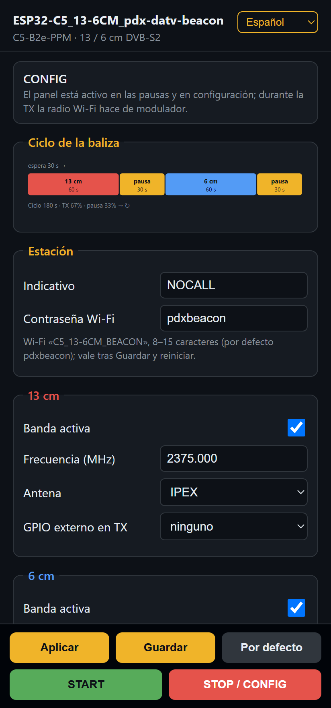
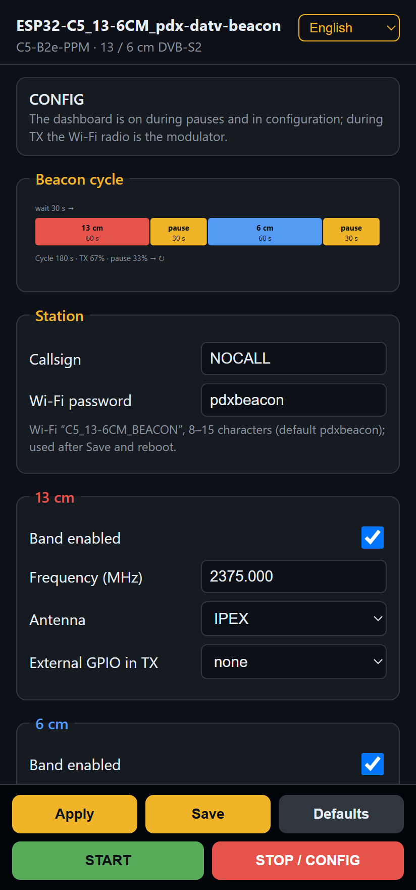

# ESP32-C5_13-6CM_pdx-datv-beacon

**Baliza DATV DVB-S2 de doble banda (13 cm y 6 cm) en un solo ESP32-C5, que usa el transmisor Wi-Fi como modulador I/Q.**

[English](README.md) · [Italiano](README_it.md) · **Español** · [Deutsch](README_de.md) · [Português](README_pt.md) · [العربية](README_ar.md) · [日本語](README_ja.md)

Panel en 11 idiomas · Licencia GPL-3.0

<table><tr><th width="50%">13 cm — 2375,000 MHz</th><th width="50%">6 cm — 5750,000 MHz</th></tr>
<tr><td></td><td></td></tr></table>

*Carta de ajuste neutra con indicativo y frecuencia ajustados desde el panel, recibida con el Pd4Pdx (Pluto + leandvb): 13 cm en la pantalla de 7" (MER 23,4 dB), 6 cm en el monitor HDMI (MER 22,8 dB, VBER 0). QPSK 3/4, 333 kS, H.265 + AAC.*

<p align="center"> </p>

*El ESP32-C5-Zero en el banco (LED azul = TX en 6 cm, antena de banda ancha en el IPEX) y el Pd4Pdx recibiéndolo en 5750 MHz.*

## Qué hace

* Genera una señal **DVB-S2 QPSK 3/4** (tramas normales, pilotos) a **125 / 250 / 333 / 500 kS**, con el transport stream MPEG (carta de ajuste en vídeo H.265 + audio AAC, SDT con tu indicativo) **construido en tiempo real en el chip**.
* Transmite alternando **13 cm (2300–2450 MHz)** y **6 cm (5650–5850 MHz)** en un ciclo de baliza: TX 13 cm → pausa → TX 6 cm → pausa.
* Funciona en una **Waveshare ESP32-C5-Zero** (ESP32-C5, un solo núcleo RISC-V, flash de 4 MB, sin PSRAM). Sin DAC externo y sin FPGA.
* **Panel web** en su propio punto de acceso (`C5_13-6CM_BEACON`, http://192.168.4.1) en 11 idiomas: indicativo, frecuencias, symbol rate, nivel, antena por banda (PCB o IPEX), GPIO para relés externos / PTT, tiempos del ciclo, **corrección del cristal en ppm** con calculadora.
* **Parada sin botones:** doble encendido, **GPIO STOP** a masa (interruptor, relé, mando a distancia) o STOP desde el panel.

| Panel (teléfono) | | |
|---|---|---|
|  |  |  |

Todos los idiomas: [DE](docs/img/dashboard_de.png) · [FR](docs/img/dashboard_fr.png) · [PT](docs/img/dashboard_pt.png) · [NL](docs/img/dashboard_nl.png) · [PL](docs/img/dashboard_pl.png) · [EL](docs/img/dashboard_el.png) · [JA](docs/img/dashboard_ja.png) · [AR](docs/img/dashboard_ar.png)

## Cómo funciona (resumen)

La radio del ESP32-C5 tiene un motor interno que reproduce muestras (Espressif lo usa para las calibraciones). Su código de transmisión ya no está en las bibliotecas del fabricante, así que los registros se encontraron por prueba: dos bancos de muestras a 40 MS/s reproducidos en ping-pong y rellenados por la CPU con QPSK filtrada RRC mientras el otro banco está en el aire, con 333 000 S/s exactos gracias a un acumulador fraccionario. BCH, LDPC, aleatorización, trama PL y multiplexor del transport stream se ejecutan en el único núcleo entre un cambio de banco y el siguiente. Detalles y todos los valores medidos: **[docs/MEASUREMENTS.md](docs/MEASUREMENTS.md)** (inglés).

## Hardware

<p align="center"></p>

*Patillaje del ESP32-C5-Zero (placa Waveshare). Este firmware usa GPIO26 (conmutador de antena), GPIO27 (LED WS2812), GPIO28 (BOOT) y GPIO10 (entrada STOP); los GPIO 0–10 y 23–25 pueden mandar relés de banda y PTT.*

| Elemento | Notas |
|---|---|
| Placa | Waveshare ESP32-C5-Zero (ESP32-C5HF4, flash de 4 MB) |
| Antena | cerámica en la placa o **IPEX** (se elige con GPIO26 desde el panel); en las pruebas, antena de banda ancha para 2,4 y 5,7 GHz |
| GPIO | 26 conmutador de antena · 27 LED de estado (amarillo = espera, rojo = TX 13 cm, azul = TX 6 cm) · 28 BOOT · **10 STOP** (entrada, a GND) · salidas opcionales 0–10, 23–25 para relés de banda y PTT |
| Alimentación | USB-C |

El nivel de salida es de pocos milivatios: para el uso real hacen falta un filtro y un amplificador externos.

## Compilar y grabar

Requiere **ESP-IDF v6.1** (target `esp32c5`).

```
cd firmware
idf.py set-target esp32c5
idf.py build
esptool --chip esp32c5 --port COMx -b 921600 write-flash 0x2000 build/bootloader/bootloader.bin 0x8000 build/partition_table/partition-table.bin 0x10000 build/pdx_c5_probe.bin
```

La baliza necesita además la carta de ajuste neutra en la flash en `0x290000` (un solo archivo para las dos bandas, unos 760 KB). Se genera en el PC con `tools/monoscope/make_es_c5.py` (ffmpeg con libx265 y la fuente libre DejaVu); el indicativo y la frecuencia **no** están en el archivo: los sobreimprime el C5 desde los ajustes del panel.

```
cd tools/monoscope
python make_es_c5.py -o ../out/c5_mono_es_neutral.bin
esptool --chip esp32c5 --port COMx -b 921600 write-flash 0x290000 ../out/c5_mono_es_neutral.bin
```

## Primer uso

1. Alimenta la placa: arranca en **configuración** (sin TX, LED amarillo fijo) porque el arranque automático está desactivado.
2. Conecta el teléfono al Wi-Fi **`C5_13-6CM_BEACON`** (contraseña `pdxbeacon`) y abre **http://192.168.4.1**.
3. Ajusta indicativo, frecuencias, antena y corrección del cristal, pulsa **Guardar** y luego **START**.
4. Durante la TX el Wi-Fi hace de modulador: el panel vuelve en cada pausa.

### Detener la baliza sin botones

* **Doble encendido:** enciende, quita la alimentación antes de 5 s y vuelve a encender → configuración, sin TX.
* **GPIO STOP:** GPIO10 a GND detiene la TX al instante y reinicia en configuración con el Wi-Fi encendido; a masa al encender impide cualquier TX.
* **Panel:** STOP / CONFIG durante una pausa.
* Con botones: BOOT siempre detiene, también en TX.

## Estado

Primera fase del proyecto terminada (noviembre de 2026). Probado en el aire: DVB-S2 en 13 y 6 cm, transport stream en tiempo real, ciclo de baliza, panel, GPIO STOP, corrección del cristal.

Próximos pasos:
* compensación por temperatura de la deriva del cristal durante la TX (~1,6 ppm/min en frío);
* symbol rate de 1000 kS;
* enlace SPI con un ESP32-S3 (panel durante la TX, transpondedor de banda cruzada, streaming desde el teléfono).

## Nota legal

Es un proyecto de **radioaficionado**. Transmitir en 13 cm y 6 cm requiere licencia de radioaficionado y respetar el plan de bandas y los límites de potencia de tu país. La radio Wi-Fi se usa fuera de sus canales y de su modulación: eres responsable de lo que transmites.

## Licencia y créditos

GPL-3.0 — ver [LICENSE](LICENSE). © 2026 Luigi D'Arcangelo, IZ7PDX.
Basado en el codificador DVB-S2 y el transport stream del [ESP32-S3-CAM_PDX DATV Beacon](https://github.com/Photoluis/Esp32s3-cam-pdx-datv-beacon).
