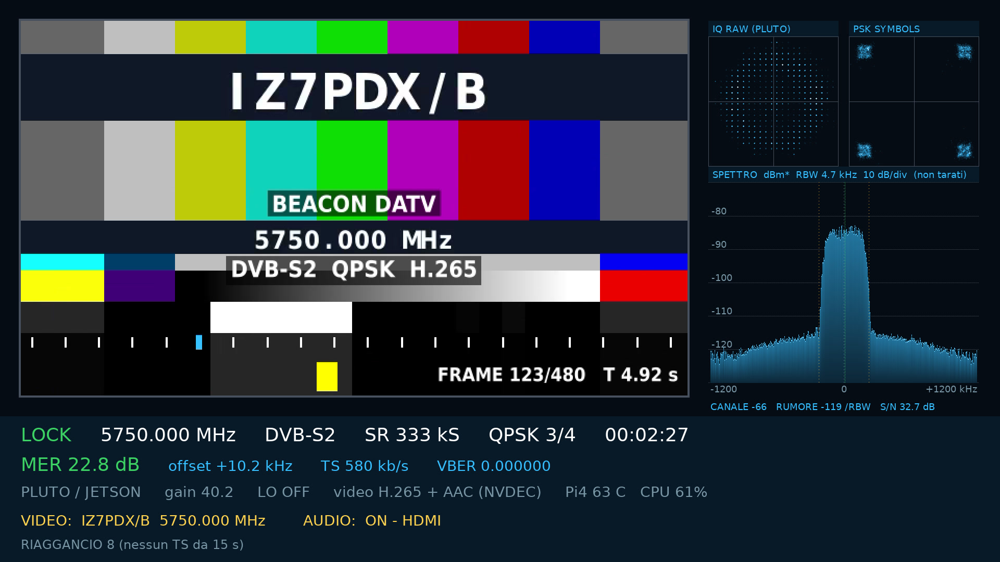
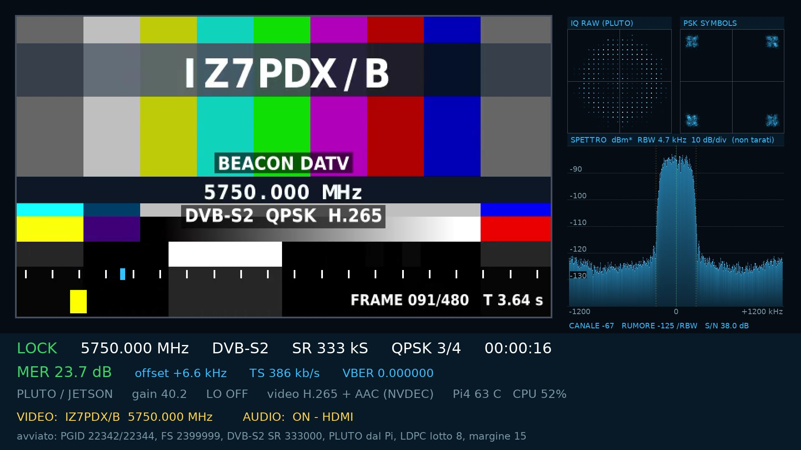
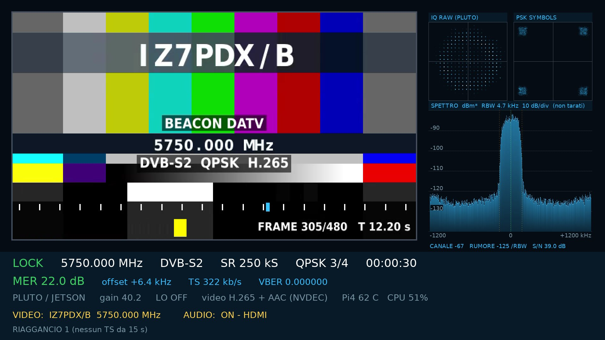
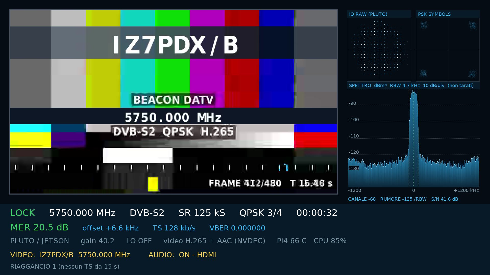
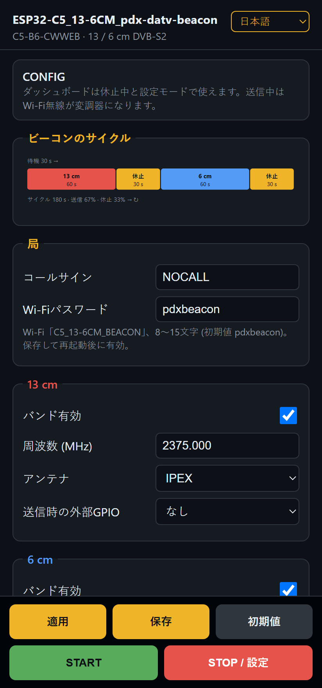

# ESP32-C5_13-6CM_pdx-datv-beacon

**Beacon DATV DVB-S2 a doppia banda (13 cm e 6 cm) su una sola ESP32-C5, che usa il trasmettitore Wi-Fi come modulatore I/Q.**

[English](README.md) · **Italiano** · [Español](README_es.md) · [Deutsch](README_de.md) · [Português](README_pt.md) · [العربية](README_ar.md) · [日本語](README_ja.md) · [Русский](README_ru.md)

Dashboard in 12 lingue · Licenza GPL-3.0

<table><tr><th width="50%">13 cm — 2375,000 MHz</th><th width="50%">6 cm — 5750,000 MHz</th></tr>
<tr><td></td><td></td></tr></table>

*Monoscopio neutro con nominativo e frequenza impostati dalla dashboard, ricevuto con il Pd4Pdx (Pluto + leandvb): 13 cm sullo schermo 7" (MER 23,4 dB), 6 cm sul monitor HDMI (MER 22,8 dB, VBER 0). QPSK 3/4, 333 kS, H.265 + AAC.*

<p align="center"> </p>

*L'ESP32-C5-Zero sul banco (LED blu = TX a 6 cm, antenna larga banda sull'IPEX) e il Pd4Pdx che la riceve a 5750 MHz.*

<table><tr><th width="33%">333 kS</th><th width="33%">250 kS</th><th width="33%">125 kS</th></tr>
<tr><td></td><td></td><td></td></tr></table>

*6 cm a tre symbol rate, ricevuti con il Pd4Pdx: 333 kS MER 23,7 dB, 250 kS MER 22,0 dB, 125 kS MER 20,5 dB, tutti in LOCK con VBER 0 (125 kS con il monoscopio leggero per gli SR bassi).*

## Cosa fa

* Genera un segnale **DVB-S2 QPSK 3/4** (frame normali, pilot) a **333 / 250 / 125 / 100 / 66 kS** (provati in ricezione: 333, 250 e 125 kS; 100 e 66 kS trasmessi correttamente ma ricezione ancora da verificare; 500 kS in sviluppo), con il transport stream MPEG (monoscopio video H.265 + audio AAC, SDT con il tuo nominativo) **costruito in tempo reale sul chip**.
* Trasmette alternando **13 cm (2300–2450 MHz)** e **6 cm (5650–5850 MHz)** in un ciclo da beacon: TX 13 cm → pausa → TX 6 cm → pausa.
* Gira su una **Waveshare ESP32-C5-Zero** (ESP32-C5, un solo core RISC-V, flash 4 MB, niente PSRAM). Nessun DAC esterno, nessuna FPGA.
* **Dashboard web** sul suo access point (`C5_13-6CM_BEACON`, http://192.168.4.1) in 12 lingue: nominativo, frequenze, symbol rate, livello, antenna per banda (PCB o IPEX), GPIO per relè esterni / PTT, tempi del ciclo, **correzione del quarzo in ppm** con calcolatore.
* **Stop senza tasti:** doppia accensione, **GPIO STOP** a massa (interruttore, relè, telecomando) oppure STOP dalla dashboard.
* **Portante CW e beacon Morse** dalla dashboard (**CW START**) o dalla seriale (`CW ON`, `CW MORSE`), con frequenza, antenna, GPIO e PTT della banda; si ferma alla durata massima, con BOOT o con il GPIO STOP.
* **Compensazione termica del quarzo:** scaldandosi da freddo il quarzo deriva fino a −8 kHz a 6 cm. In CW / Morse il PLL segue la temperatura del chip ogni secondo (misurato: da 8,6 kHz a 1,6 kHz picco-picco in 5 minuti); in DVB-S2 il PLL non può cambiare durante un segmento, quindi ogni segmento parte già centrato sulla deriva prevista (errore massimo dimezzato). Attivazione e temperatura di riferimento dalla dashboard.

| Dashboard (telefono) | | |
|---|---|---|
|  |  |  |

Tutte le lingue: [DE](docs/img/dashboard_de.png) · [ES](docs/img/dashboard_es.png) · [FR](docs/img/dashboard_fr.png) · [PT](docs/img/dashboard_pt.png) · [NL](docs/img/dashboard_nl.png) · [PL](docs/img/dashboard_pl.png) · [EL](docs/img/dashboard_el.png) · [AR](docs/img/dashboard_ar.png) · [RU](docs/img/dashboard_ru.png) — pagina intera: [IT](docs/img/dashboard_full_it.png) · [EN](docs/img/dashboard_full_en.png) · [JA](docs/img/dashboard_full_ja.png)

## Come funziona (in breve)

La radio della ESP32-C5 ha un motore interno che riproduce campioni (Espressif lo usa per le calibrazioni). Il suo codice di trasmissione non c'è più nelle librerie del costruttore, quindi i registri sono stati trovati per prova: due banchi di campioni a 40 MS/s suonati a ping-pong e riempiti dalla CPU con la QPSK filtrata RRC mentre l'altro banco è in onda, con 333 000 S/s esatti grazie a un accumulatore frazionario. BCH, LDPC, scrambling, trama PL e multiplexer del transport stream girano tutti sull'unico core negli intervalli tra uno scambio e l'altro. Dettagli e tutti i valori misurati: **[docs/MISURE_it.md](docs/MISURE_it.md)**.

## Hardware

<p align="center"></p>

*Piedinatura della ESP32-C5-Zero (scheda Waveshare). Questo firmware usa GPIO26 (commutatore d'antenna), GPIO27 (LED WS2812), GPIO28 (BOOT) e GPIO10 (ingresso STOP); i GPIO 0–10 e 23–25 possono comandare relè di banda e PTT.*

| Voce | Note |
|---|---|
| Scheda | Waveshare ESP32-C5-Zero (ESP32-C5HF4, flash 4 MB) |
| Antenna | ceramica sulla scheda o **IPEX** (scelta con GPIO26 dalla dashboard); nelle prove un'antenna larga banda per 2,4 e 5,7 GHz |
| GPIO | 26 commutatore d'antenna · 27 LED di stato (giallo = attesa, rosso = TX 13 cm, blu = TX 6 cm) · 28 BOOT · **10 STOP** (ingresso, a GND) · uscite facoltative 0–10, 23–25 per relè di banda e PTT |
| Alimentazione | USB-C |

Il livello d'uscita è di pochi milliwatt: per l'uso reale servono un filtro e un amplificatore esterni.

## Compilare e caricare

**Il modo più semplice: installazione dal browser** (Chrome o Edge su un computer, senza ESP-IDF): **[installazione web](https://photoluis.github.io/ESP32-C5_13-6CM_pdx-datv-beacon/install/)**. Scrive il firmware e i due monoscopi. Per compilarlo da soli:

Serve **ESP-IDF v6.1** (target `esp32c5`).

```
cd firmware
idf.py set-target esp32c5
idf.py build
esptool --chip esp32c5 --port COMx -b 921600 write-flash 0x2000 build/bootloader/bootloader.bin 0x8000 build/partition_table/partition-table.bin 0x10000 build/pdx_c5_probe.bin
```

Il beacon ha bisogno anche del monoscopio neutro in flash a `0x290000` (un solo file per le due bande, circa 700 KB). Si genera sul PC con `tools/monoscope/make_es_c5.py` (ffmpeg con libx265 e il font libero DejaVu); nominativo e frequenza **non** sono nel file: li sovrimprime la C5 dalle impostazioni della dashboard.

```
cd tools/monoscope
python make_es_c5.py -o ../out/c5_mono_es_neutral.bin
esptool --chip esp32c5 --port COMx -b 921600 write-flash 0x290000 ../out/c5_mono_es_neutral.bin
```

**Symbol rate bassi:** sotto i 333 kS il monoscopio standard non entra nel flusso. Generane uno più leggero per l'SR più basso che userai (`--sr`) e scrivilo a `0x340000`: sotto i 333 kS la C5 lo sceglie da sola, da 333 kS in su usa quello standard a `0x290000` (immagine migliore). Con due monoscopi quello a `0x290000` deve restare sotto i 704 KB.

```
python make_es_c5.py --sr 125000 -o ../out/c5_mono_es_neutral_125000.bin
esptool --chip esp32c5 --port COMx -b 921600 write-flash 0x340000 ../out/c5_mono_es_neutral_125000.bin
```

**Monoscopio personale:** al posto delle barre si può usare una propria immagine (`--image`, adattata a 640x360) o un breve video (`--video`, ripetuto o tagliato a 19,2 s × `--loops`), con il suo audio (`--audio`, altrimenti un tono da 1 kHz). La striscia del nominativo è scurita al 50 %, così l'immagine resta visibile dietro; quella della frequenza è piena. Con un video la zona delle strisce resta ferma sul primo fotogramma. `--preview` compone le strisce come la C5 e decodifica il risultato per controllo. Il file va a `0x290000` come quello standard (massimo 1,4 MB).

```
python make_es_c5.py --image my_card.jpg -o ../out/my_card.bin
python make_es_c5.py --video clip.mp4 --audio clip.mp4 --loops 1 -o ../out/my_clip.bin
python make_es_c5.py --image my_card.jpg --preview "IZ7PDX/B" "2375.000 MHz" -o ../out/my_card.bin
```

## Primo utilizzo

1. Alimenta la scheda: parte in **configurazione** (nessuna TX, LED giallo fisso) perché la partenza automatica è spenta.
2. Collega il telefono al Wi-Fi **`C5_13-6CM_BEACON`** (password `pdxbeacon`) e apri **http://192.168.4.1**.
3. Imposta nominativo, frequenze, antenna e correzione del quarzo, premi **Salva**, poi **START**.
4. Durante la TX il Wi-Fi fa da modulatore: la dashboard torna a ogni pausa.

### Fermare il beacon senza tasti

* **Doppia accensione:** accendi, togli l'alimentazione entro 5 s e riaccendi → configurazione, nessuna TX.
* **GPIO STOP:** GPIO10 a GND ferma subito la TX e riavvia in configurazione con il Wi-Fi acceso; tenuto a massa all'accensione impedisce ogni TX.
* **Dashboard:** STOP / CONFIG durante una pausa.
* Con i tasti: BOOT ferma sempre, anche in TX.

## Stato

Prima fase del progetto completata (novembre 2026). Provato in aria: DVB-S2 a 13 e 6 cm, transport stream in tempo reale, ciclo del beacon, dashboard, GPIO STOP, correzione del quarzo.

23 novembre 2026: CW / Morse dalla dashboard e compensazione termica del quarzo, provate anche in aria; 125 kS ricevuto con immagine (LOCK, MER 23,5 dB, VBER 0).

Prossimi passi:
* prove in ricezione a 100 e 66 kS; 500 kS;
* symbol rate 1000 kS;
* collegamento SPI con una ESP32-S3 (dashboard durante la TX, transponder in banda incrociata, streaming dal telefono).

## Nota legale

È un progetto **radioamatoriale**. Trasmettere a 13 cm e 6 cm richiede la licenza di radioamatore e il rispetto del piano di banda e dei limiti di potenza nazionali. La radio Wi-Fi viene usata fuori dai suoi canali e dalla sua modulazione: sei responsabile di ciò che trasmetti.

## Licenza e crediti

GPL-3.0 — vedi [LICENSE](LICENSE). © 2026 Luigi D'Arcangelo, IZ7PDX.
Basato sul codificatore DVB-S2 e sul transport stream dell'[ESP32-S3-CAM_PDX DATV Beacon](https://github.com/Photoluis/Esp32s3-cam-pdx-datv-beacon).
