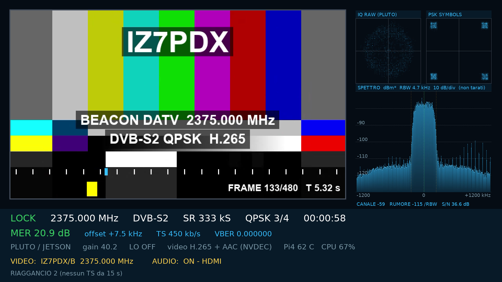
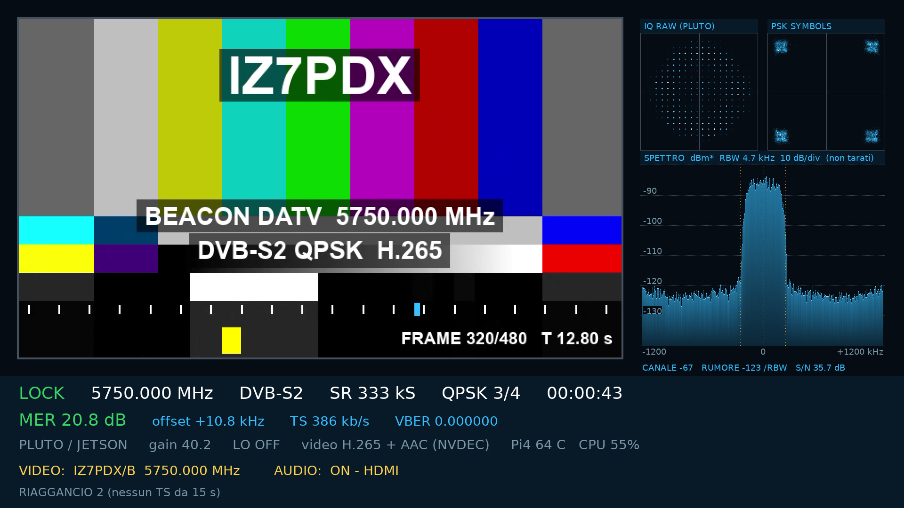
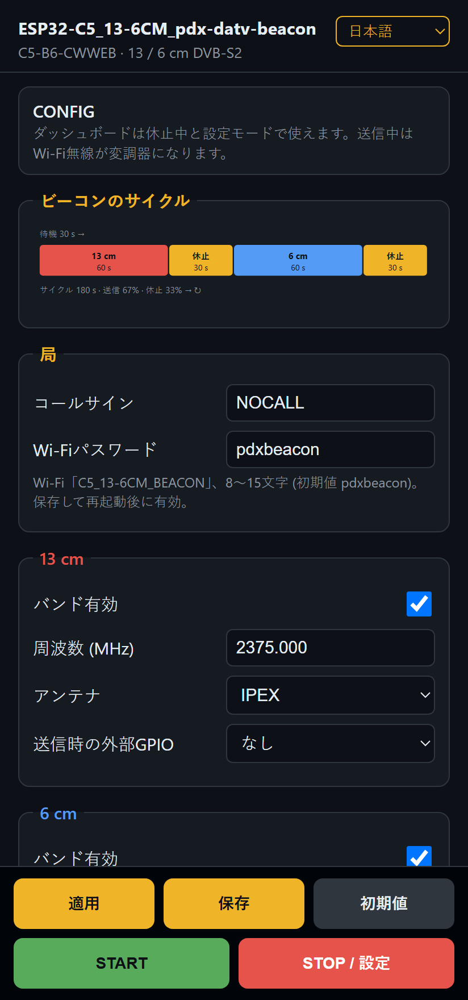
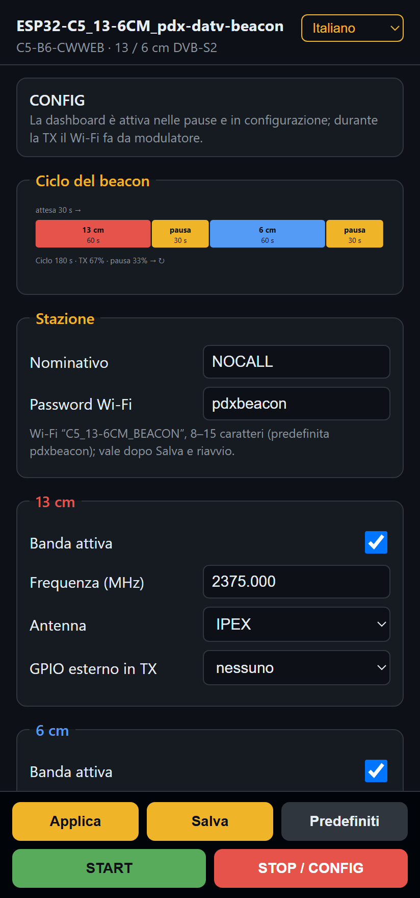

# ESP32-C5_13-6CM_pdx-datv-beacon

**1 個の ESP32-C5 で動くデュアルバンド(13 cm / 6 cm)DVB-S2 DATV ビーコン。Wi-Fi 送信機を I/Q 変調器として使います。**

[English](README.md) · [Italiano](README_it.md) · ダッシュボードは 11 言語 · ライセンス GPL-3.0

| 13 cm — 2375.000 MHz | 6 cm — 5750.000 MHz |
|---|---|
|  |  |

*Pluto + leandvb の局で両バンドを受信: QPSK 3/4、333 kS、H.265 + AAC テストカード、MER 約 21 dB、VBER 0。*

## 機能

* **DVB-S2 QPSK 3/4**(ノーマルフレーム、パイロット)を **125 / 250 / 333 / 500 kS** で生成。MPEG トランスポートストリーム(H.265 映像 + AAC 音声のテストカード、コールサイン入り SDT)は**チップ上で実時間に構築**します。
* ビーコンサイクルで **13 cm(2300–2450 MHz)** と **6 cm(5650–5850 MHz)** を交互に送信: 13 cm 送信 → 休止 → 6 cm 送信 → 休止。
* **Waveshare ESP32-C5-Zero**(ESP32-C5、RISC-V シングルコア、フラッシュ 4 MB、PSRAM なし)で動作。外付け DAC も FPGA も不要です。
* 専用アクセスポイント(`C5_13-6CM_BEACON`、http://192.168.4.1)上の **Web ダッシュボード**(11 言語): コールサイン、周波数、シンボルレート、レベル、バンドごとのアンテナ(基板 / IPEX)、外部リレー・PTT 用 GPIO、サイクル時間、計算機付きの **水晶補正(ppm)**。
* **ボタンなしで停止:** 2 回電源投入、**STOP GPIO** を GND に接続(スイッチ、リレー、リモコン)、またはダッシュボードの STOP。

| ダッシュボード(スマートフォン) | | |
|---|---|---|
|  |  |  |

全言語: [DE](docs/img/dashboard_de.png) · [ES](docs/img/dashboard_es.png) · [FR](docs/img/dashboard_fr.png) · [PT](docs/img/dashboard_pt.png) · [NL](docs/img/dashboard_nl.png) · [PL](docs/img/dashboard_pl.png) · [EL](docs/img/dashboard_el.png) · [AR](docs/img/dashboard_ar.png) — ページ全体: [JA](docs/img/dashboard_full_ja.png) · [EN](docs/img/dashboard_full_en.png) · [IT](docs/img/dashboard_full_it.png)

## 仕組み(概要)

ESP32-C5 の無線部には、Espressif が校正に使うサンプル再生エンジンがあります。その送信用コードはベンダーライブラリから削除されているため、レジスタは実験で見つけました。40 MS/s のサンプルバンク 2 つをピンポンで再生し、片方が送信中にもう片方へ CPU が RRC フィルタ済み QPSK を書き込みます。333 000 S/s ちょうどは分数アキュムレータで実現しています。BCH、LDPC、スクランブル、PL フレーム、TS 多重化はすべて、バンク切替の合間に 1 つのコアで処理されます。詳細と測定値: **[docs/MEASUREMENTS_ja.md](docs/MEASUREMENTS_ja.md)**。

## ハードウェア

| 項目 | 備考 |
|---|---|
| ボード | Waveshare ESP32-C5-Zero(ESP32-C5HF4、フラッシュ 4 MB) |
| アンテナ | 基板上のセラミックまたは **IPEX**(ダッシュボードから GPIO26 で選択)。試験では 2.4 / 5.7 GHz の広帯域アンテナを使用 |
| GPIO | 26 アンテナ切替 · 27 状態 LED(黄 = 待機、赤 = 13 cm 送信、青 = 6 cm 送信)· 28 BOOT · **10 STOP**(入力、GND で有効)· バンドリレーと PTT 用の出力 0–10、23–25 |
| 電源 | USB-C |

出力は数ミリワットです。実運用には外部のフィルタとアンプが必要です。

## ビルドと書込み

**ESP-IDF v6.1**(ターゲット `esp32c5`)が必要です。

```
cd firmware
idf.py set-target esp32c5
idf.py build
esptool --chip esp32c5 --port COMx -b 921600 write-flash 0x2000 build/bootloader/bootloader.bin 0x8000 build/partition_table/partition-table.bin 0x10000 build/pdx_c5_probe.bin
```

ビーコンには、フラッシュ上にエンコード済みテストカード 2 つ(6 cm は `0x290000`、13 cm は `0x320000`)も必要です。**ニュートラルなテストカードと書込み用イメージは最初のリリースで公開します**。これらは [ESP32-S3-CAM_PDX DATV Beacon](https://github.com/Photoluis/Esp32s3-cam-pdx-datv-beacon) プロジェクトの `make_es` ツールで作成します。

## 初回の使い方

1. 電源を入れると**設定モード**で起動します(自動スタートが OFF のため送信なし、黄色 LED 点灯)。
2. スマートフォンを Wi-Fi **`C5_13-6CM_BEACON`**(パスワード `pdxbeacon`)に接続し、**http://192.168.4.1** を開きます。
3. コールサイン、周波数、アンテナ、水晶補正を設定して**保存**し、**START** を押します。
4. 送信中は Wi-Fi が変調器になるため、ダッシュボードは各休止中に戻ります。

### ボタンなしでビーコンを止める

* **2 回電源投入:** 電源を入れ、5 秒以内に切って再投入 → 設定モード、送信なし。
* **STOP GPIO:** GPIO10 を GND に接続すると送信をすぐ止め、Wi-Fi オンの設定モードで再起動。電源投入時に GND なら送信しません。
* **ダッシュボード:** 休止中に STOP / 設定。
* ボタン: BOOT は送信中でも常に停止します。

## 状況

プロジェクトの第 1 段階が完了しました(2026 年 11 月)。実電波で確認済み: 13 cm と 6 cm の DVB-S2、実時間 TS、ビーコンサイクル、ダッシュボード、STOP GPIO、水晶補正。

次の段階:
* 送信中の水晶ドリフト(冷えた状態から約 1.6 ppm/分)の温度補償
* ダッシュボードで入力したコールサインをテストカードに重ねる
* 1000 kS のシンボルレート
* ESP32-S3 との SPI 接続(送信中のダッシュボード、クロスバンド・トランスポンダ、スマートフォンからのストリーミング)

## 法的注意

これは**アマチュア無線**のプロジェクトです。13 cm と 6 cm での送信にはアマチュア無線の免許が必要で、各国のバンドプランと電力制限を守る必要があります。Wi-Fi 無線を本来のチャンネルと変調以外で使うため、送信内容の責任は利用者にあります。

## ライセンスとクレジット

GPL-3.0 — [LICENSE](LICENSE) を参照。© 2026 Luigi D'Arcangelo, IZ7PDX.
[ESP32-S3-CAM_PDX DATV Beacon](https://github.com/Photoluis/Esp32s3-cam-pdx-datv-beacon) の DVB-S2 エンコーダと TS コードを基にしています。Claude(Anthropic)の支援を受けて開発しました。
