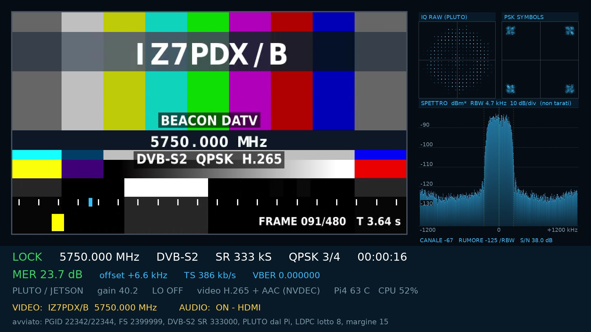
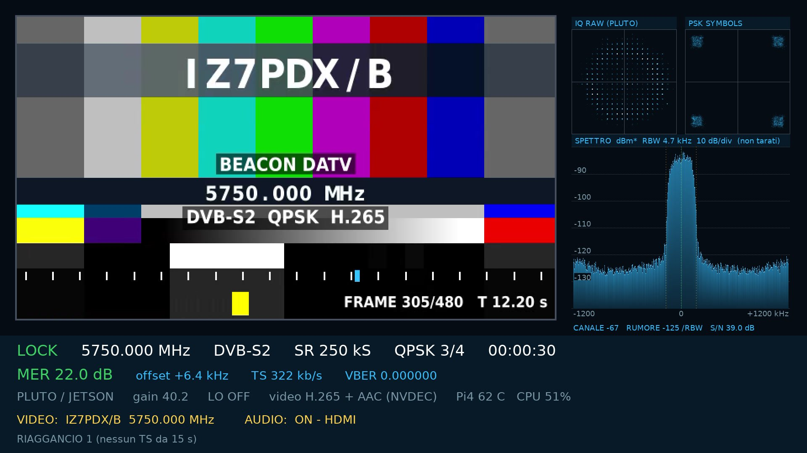
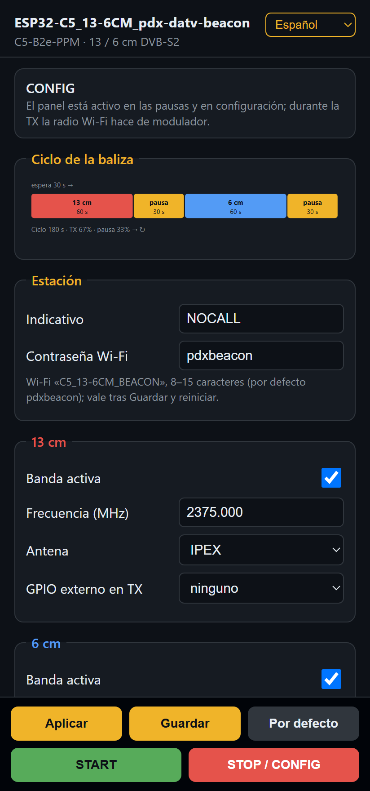

# ESP32-C5_13-6CM_pdx-datv-beacon

**Farol DATV DVB-S2 de banda dupla (13 cm e 6 cm) num único ESP32-C5, que usa o transmissor Wi-Fi como modulador I/Q.**

[English](README.md) · [Italiano](README_it.md) · [Español](README_es.md) · [Deutsch](README_de.md) · **Português** · [العربية](README_ar.md) · [日本語](README_ja.md) · [Русский](README_ru.md)

Painel em 12 línguas · Licença GPL-3.0

<table><tr><th width="50%">13 cm — 2375,000 MHz</th><th width="50%">6 cm — 5750,000 MHz</th></tr>
<tr><td></td><td></td></tr></table>

*Padrão de teste neutro com indicativo e frequência definidos no painel, recebido com o Pd4Pdx (Pluto + leandvb): 13 cm no ecrã de 7" (MER 23,4 dB), 6 cm no monitor HDMI (MER 22,8 dB, VBER 0). QPSK 3/4, 333 kS, H.265 + AAC.*

<p align="center"> </p>

*O ESP32-C5-Zero na bancada (LED azul = TX em 6 cm, antena de banda larga no IPEX) e o Pd4Pdx a recebê-lo em 5750 MHz.*

<table><tr><th width="33%">333 kS</th><th width="33%">250 kS</th><th width="33%">125 kS</th></tr>
<tr><td></td><td></td><td></td></tr></table>

*6 cm a três symbol rates, recebidos com o Pd4Pdx: 333 kS MER 23,7 dB, 250 kS MER 22,0 dB, 125 kS MER 20,5 dB, todos com LOCK e VBER 0 (125 kS com o padrão de teste leve para SR baixos).*

## O que faz

* Gera um sinal **DVB-S2 QPSK 3/4** (tramas normais, pilotos) a **333 / 250 / 125 / 100 / 66 kS** (testados na receção: 333, 250 e 125 kS; 100 e 66 kS transmitidos corretamente mas receção ainda por verificar; 500 kS em desenvolvimento), com o transport stream MPEG (padrão de teste em vídeo H.265 + áudio AAC, SDT com o seu indicativo) **construído em tempo real no chip**.
* Transmite alternando **13 cm (2300–2450 MHz)** e **6 cm (5650–5850 MHz)** num ciclo de farol: TX 13 cm → pausa → TX 6 cm → pausa.
* Funciona numa **Waveshare ESP32-C5-Zero** (ESP32-C5, um só núcleo RISC-V, flash de 4 MB, sem PSRAM). Sem DAC externo e sem FPGA.
* **Painel web** no seu próprio ponto de acesso (`C5_13-6CM_BEACON`, http://192.168.4.1) em 12 línguas: indicativo, frequências, symbol rate, nível, antena por banda (PCB ou IPEX), GPIO para relés externos / PTT, tempos do ciclo, **correção do cristal em ppm** com calculadora.
* **Paragem sem botões:** duplo arranque, **GPIO STOP** à massa (interruptor, relé, comando remoto) ou STOP no painel.
* **Portadora CW e farol Morse** a partir do painel (**CW START**) ou da porta série (`CW ON`, `CW MORSE`), com a frequência, a antena, os GPIO e o PTT da banda; para no fim da duração máxima, com BOOT ou com o GPIO STOP. **Experimental:** a portadora CW não modulada e o Morse precisam ainda de mais testes no ar antes de serem considerados estáveis.
* **Compensação térmica do cristal:** ao aquecer a partir do frio o cristal deriva até −8 kHz em 6 cm. Em CW / Morse o PLL segue a temperatura do chip a cada segundo (medido: de 8,6 kHz para 1,6 kHz pico a pico em 5 minutos); em DVB-S2 o PLL não pode mudar durante um segmento, por isso cada segmento começa já centrado na deriva prevista (erro máximo reduzido a metade). Ativação e temperatura de referência no painel.

| Painel (telemóvel) | | |
|---|---|---|
|  |  |  |

Todas as línguas: [IT](docs/img/dashboard_it.png) · [DE](docs/img/dashboard_de.png) · [FR](docs/img/dashboard_fr.png) · [NL](docs/img/dashboard_nl.png) · [PL](docs/img/dashboard_pl.png) · [EL](docs/img/dashboard_el.png) · [JA](docs/img/dashboard_ja.png) · [AR](docs/img/dashboard_ar.png) · [RU](docs/img/dashboard_ru.png)

## Como funciona (resumo)

O rádio do ESP32-C5 tem um motor interno que reproduz amostras (a Espressif usa-o nas calibrações). O seu código de transmissão já não está nas bibliotecas do fabricante, por isso os registos foram encontrados por ensaio: dois bancos de amostras a 40 MS/s tocados em ping-pong e preenchidos pela CPU com QPSK filtrada RRC enquanto o outro banco está no ar, com 333 000 S/s exatos graças a um acumulador fracionário. BCH, LDPC, baralhamento, trama PL e multiplexador do transport stream correm todos no único núcleo entre trocas de banco. Detalhes e todos os valores medidos: **[docs/MEASUREMENTS.md](docs/MEASUREMENTS.md)** (inglês).

## Hardware

<p align="center"></p>

*Pinagem do ESP32-C5-Zero (placa Waveshare). Este firmware usa GPIO26 (comutador de antena), GPIO27 (LED WS2812), GPIO28 (BOOT) e GPIO10 (entrada STOP); os GPIO 0–10 e 23–25 podem comandar relés de banda e PTT.*

| Item | Notas |
|---|---|
| Placa | Waveshare ESP32-C5-Zero (ESP32-C5HF4, flash de 4 MB) |
| Antena | cerâmica na placa ou **IPEX** (escolhida por GPIO26 no painel); nos testes, antena de banda larga para 2,4 e 5,7 GHz |
| GPIO | 26 comutador de antena · 27 LED de estado (amarelo = espera, vermelho = TX 13 cm, azul = TX 6 cm) · 28 BOOT · **10 STOP** (entrada, a GND) · saídas opcionais 0–10, 23–25 para relés de banda e PTT |
| Alimentação | USB-C |

O nível de saída é de poucos miliwatts: para uso real são necessários um filtro e um amplificador externos.

## Compilar e gravar

**A forma mais simples: instalação a partir do navegador** (Chrome ou Edge num computador, sem ESP-IDF): **[instalador web](https://photoluis.github.io/ESP32-C5_13-6CM_pdx-datv-beacon/install/)**. Grava o firmware e os dois padrões de teste. Para compilar por conta própria:

Requer **ESP-IDF v6.1** (target `esp32c5`).

```
cd firmware
idf.py set-target esp32c5
idf.py build
esptool --chip esp32c5 --port COMx -b 921600 write-flash 0x2000 build/bootloader/bootloader.bin 0x8000 build/partition_table/partition-table.bin 0x10000 build/pdx_c5_probe.bin
```

O farol precisa também do padrão de teste neutro na flash em `0x290000` (um só ficheiro para as duas bandas, cerca de 700 KB). É gerado no PC com `tools/monoscope/make_es_c5.py` (ffmpeg com libx265 e a fonte livre DejaVu); o indicativo e a frequência **não** estão no ficheiro: o C5 sobrepõe-nos a partir das definições do painel.

```
cd tools/monoscope
python make_es_c5.py -o ../out/c5_mono_es_neutral.bin
esptool --chip esp32c5 --port COMx -b 921600 write-flash 0x290000 ../out/c5_mono_es_neutral.bin
```

**Symbol rates baixos:** abaixo de 333 kS o padrão de teste normal não cabe no fluxo. Gere um mais leve para o SR mais baixo que vai usar (`--sr`) e grave-o em `0x340000`: abaixo de 333 kS a C5 escolhe-o sozinha; a partir de 333 kS usa o normal em `0x290000` (melhor imagem). Com dois padrões, o de `0x290000` tem de ficar abaixo de 704 KB.

```
python make_es_c5.py --sr 125000 -o ../out/c5_mono_es_neutral_125000.bin
esptool --chip esp32c5 --port COMx -b 921600 write-flash 0x340000 ../out/c5_mono_es_neutral_125000.bin
```

**Padrão de teste pessoal:** em vez das barras pode usar uma imagem própria (`--image`, adaptada a 640x360) ou um vídeo curto (`--video`, repetido ou cortado a 19,2 s × `--loops`), com o seu áudio (`--audio`, caso contrário um tom de 1 kHz). A faixa do indicativo é escurecida a 50 % para que a imagem continue visível por trás; a da frequência é opaca. Com um vídeo a zona das faixas fica parada no primeiro fotograma. `--preview` compõe as faixas como a C5 e descodifica o resultado para verificação. O ficheiro vai para `0x290000` como o padrão (máximo 1,4 MB).

```
python make_es_c5.py --image my_card.jpg -o ../out/my_card.bin
python make_es_c5.py --video clip.mp4 --audio clip.mp4 --loops 1 -o ../out/my_clip.bin
python make_es_c5.py --image my_card.jpg --preview "IZ7PDX/B" "2375.000 MHz" -o ../out/my_card.bin
```

## Primeira utilização

1. Alimente a placa: arranca em **configuração** (sem TX, LED amarelo fixo) porque o arranque automático está desligado.
2. Ligue o telemóvel ao Wi-Fi **`C5_13-6CM_BEACON`** (palavra-passe `pdxbeacon`) e abra **http://192.168.4.1**.
3. Defina indicativo, frequências, antena e correção do cristal, prima **Guardar** e depois **START**.
4. Durante a TX o Wi-Fi serve de modulador: o painel volta em cada pausa.

### Parar o farol sem botões

* **Duplo arranque:** ligue, retire a alimentação em menos de 5 s e volte a ligar → configuração, sem TX.
* **GPIO STOP:** GPIO10 a GND para a TX de imediato e reinicia em configuração com o Wi-Fi ligado; à massa ao ligar impede qualquer TX.
* **Painel:** STOP / CONFIG durante uma pausa.
* Com botões: BOOT para sempre, também em TX.

## Estado

Primeira fase do projeto concluída (novembro de 2026). Testado no ar: DVB-S2 em 13 e 6 cm, transport stream em tempo real, ciclo do farol, painel, GPIO STOP, correção do cristal.

23 de novembro de 2026: CW / Morse a partir do painel e compensação térmica do cristal, testadas também no ar; 125 kS recebido com imagem (LOCK, MER 23,5 dB, VBER 0).

Próximos passos:
* testes de receção a 100 e 66 kS; 500 kS;
* symbol rate de 1000 kS;
* ligação SPI a um ESP32-S3 (painel durante a TX, transponder de banda cruzada, streaming a partir do telemóvel).

## Nota legal

Este é um projeto de **radioamador**. Transmitir em 13 cm e 6 cm exige licença de radioamador e o respeito pelo plano de bandas e pelos limites de potência do seu país. O rádio Wi-Fi é usado fora dos seus canais e da sua modulação: é responsável pelo que transmite.

## Licença e créditos

GPL-3.0 — ver [LICENSE](LICENSE). © 2026 Luigi D'Arcangelo, IZ7PDX.
Baseado no codificador DVB-S2 e no transport stream do [ESP32-S3-CAM_PDX DATV Beacon](https://github.com/Photoluis/Esp32s3-cam-pdx-datv-beacon).
