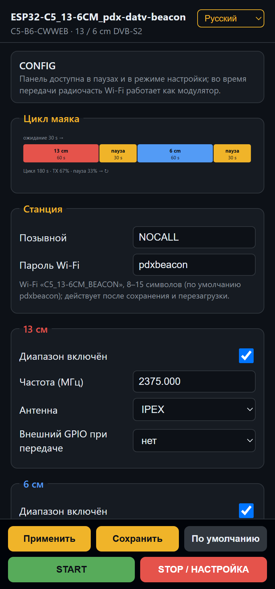

# ESP32-C5_13-6CM_pdx-datv-beacon

**Двухдиапазонный маяк DATV DVB-S2 (13 см и 6 см) на одной ESP32-C5, использующий передатчик Wi-Fi как I/Q-модулятор.**

[English](README.md) · [Italiano](README_it.md) · [Español](README_es.md) · [Deutsch](README_de.md) · [Português](README_pt.md) · [العربية](README_ar.md) · [日本語](README_ja.md) · **Русский**

Панель управления на 12 языках · Лицензия GPL-3.0

<table><tr><th width="50%">13 см — 2375,000 МГц</th><th width="50%">6 см — 5750,000 МГц</th></tr>
<tr><td></td><td></td></tr></table>

*Нейтральная испытательная таблица с позывным и частотой, заданными в панели, принятая на Pd4Pdx (Pluto + leandvb): 13 см на 7-дюймовом экране (MER 23,4 дБ), 6 см на мониторе HDMI (MER 22,8 дБ, VBER 0). QPSK 3/4, 333 kS, H.265 + AAC.*

<p align="center"> </p>

*ESP32-C5-Zero на стенде (синий светодиод = передача на 6 см, широкополосная антенна на IPEX) и Pd4Pdx, принимающий её на 5750 МГц.*

## Что он делает

* Формирует сигнал **DVB-S2 QPSK 3/4** (нормальные кадры, пилоты) со скоростью **333 / 250 / 125 / 100 / 66 kS** (проверены на приёме: 333 и 125 kS; 250, 100 и 66 kS передаются правильно, но приём ещё не проверен; 500 kS в разработке); транспортный поток MPEG (испытательная таблица: видео H.265 + звук AAC, SDT с вашим позывным) **строится на чипе в реальном времени**.
* Передаёт поочерёдно на **13 см (2300–2450 МГц)** и **6 см (5650–5850 МГц)** в цикле маяка: передача 13 см → пауза → передача 6 см → пауза.
* Работает на **Waveshare ESP32-C5-Zero** (ESP32-C5, одно ядро RISC-V, флеш 4 МБ, без PSRAM). Без внешнего ЦАП и без ПЛИС.
* **Веб-панель** на собственной точке доступа (`C5_13-6CM_BEACON`, http://192.168.4.1) на 12 языках: позывной, частоты, символьная скорость, уровень, антенна для каждого диапазона (PCB или IPEX), GPIO для внешних реле / PTT, времена цикла, **коррекция кварца в ppm** с калькулятором.
* **Остановка без кнопок:** двойное включение, **GPIO STOP** на массу (выключатель, реле, пульт ДУ) или STOP в панели.
* **Несущая CW и маяк Морзе** из панели (**CW START**) или через последовательный порт (`CW ON`, `CW MORSE`), с частотой, антенной, GPIO и PTT диапазона; остановка по истечении максимальной длительности, кнопкой BOOT или через GPIO STOP.
* **Термокомпенсация кварца:** при прогреве из холодного состояния кварц уходит до −8 кГц на 6 см. В CW / Морзе PLL каждую секунду следует за температурой чипа (измерено: с 8,6 кГц до 1,6 кГц от пика до пика за 5 минут); в DVB-S2 PLL нельзя менять во время сегмента, поэтому каждый сегмент начинается уже отцентрированным на ожидаемый уход (максимальная ошибка уменьшается вдвое). Включение / выключение и опорная температура — в панели.

| Панель (телефон) | | |
|---|---|---|
|  |  |  |

Все языки: [DE](docs/img/dashboard_de.png) · [ES](docs/img/dashboard_es.png) · [FR](docs/img/dashboard_fr.png) · [PT](docs/img/dashboard_pt.png) · [NL](docs/img/dashboard_nl.png) · [PL](docs/img/dashboard_pl.png) · [EL](docs/img/dashboard_el.png) · [AR](docs/img/dashboard_ar.png) · [JA](docs/img/dashboard_ja.png) — вся страница: [EN](docs/img/dashboard_full_en.png) · [IT](docs/img/dashboard_full_it.png) · [JA](docs/img/dashboard_full_ja.png)

## Как это работает (кратко)

В радиочасти ESP32-C5 есть внутренний блок воспроизведения отсчётов (Espressif использует его для калибровки). Его код передачи в библиотеках производителя больше отсутствует, поэтому регистры были найдены экспериментально: два банка отсчётов по 40 MS/s воспроизводятся попеременно (ping-pong), а процессор заполняет один банк QPSK-символами с фильтром RRC, пока другой в эфире; точные 333 000 S/s получаются дробным накопителем. BCH, LDPC, скремблирование, кадрирование PL и мультиплексор транспортного потока работают на единственном ядре в промежутках между переключениями банков. Подробности и все измеренные значения: **[docs/MEASUREMENTS.md](docs/MEASUREMENTS.md)** (на английском).

## Аппаратная часть

<p align="center"></p>

*Распиновка ESP32-C5-Zero (плата Waveshare). Прошивка использует GPIO26 (переключатель антенны), GPIO27 (светодиод WS2812), GPIO28 (BOOT) и GPIO10 (вход STOP); GPIO 0–10 и 23–25 могут управлять реле диапазонов и PTT.*

| Элемент | Примечания |
|---|---|
| Плата | Waveshare ESP32-C5-Zero (ESP32-C5HF4, флеш 4 МБ) |
| Антенна | керамическая на плате или **IPEX** (выбирается через GPIO26 из панели); при испытаниях использовалась широкополосная антенна на 2,4 и 5,7 ГГц |
| GPIO | 26 переключатель антенны · 27 светодиод состояния (жёлтый = ожидание, красный = передача 13 см, синий = передача 6 см) · 28 BOOT · **10 STOP** (вход, на GND) · дополнительные выходы 0–10, 23–25 для реле диапазонов и PTT |
| Питание | USB-C |

Выходной уровень — несколько милливатт: для реальной работы нужны внешний фильтр и усилитель.

## Сборка и прошивка

Требуется **ESP-IDF v6.1** (цель `esp32c5`).

```
cd firmware
idf.py set-target esp32c5
idf.py build
esptool --chip esp32c5 --port COMx -b 921600 write-flash 0x2000 build/bootloader/bootloader.bin 0x8000 build/partition_table/partition-table.bin 0x10000 build/pdx_c5_probe.bin
```

Маяку также нужна нейтральная испытательная таблица во флеше по адресу `0x290000` (один файл для обоих диапазонов, около 700 КБ). Она создаётся на ПК скриптом `tools/monoscope/make_es_c5.py` (ffmpeg с libx265 и свободный шрифт DejaVu); позывного и частоты в файле **нет**: C5 накладывает их по настройкам панели.

```
cd tools/monoscope
python make_es_c5.py -o ../out/c5_mono_es_neutral.bin
esptool --chip esp32c5 --port COMx -b 921600 write-flash 0x290000 ../out/c5_mono_es_neutral.bin
```

**Низкие символьные скорости:** ниже 333 kS стандартная испытательная таблица не помещается в поток. Создайте более лёгкую для самой низкой используемой скорости (`--sr`) и запишите её по адресу `0x340000`: ниже 333 kS C5 выбирает её сама, начиная с 333 kS используется стандартная по адресу `0x290000` (лучше качество). При двух таблицах файл по адресу `0x290000` должен быть меньше 704 КБ.

```
python make_es_c5.py --sr 125000 -o ../out/c5_mono_es_neutral_125000.bin
esptool --chip esp32c5 --port COMx -b 921600 write-flash 0x340000 ../out/c5_mono_es_neutral_125000.bin
```

**Собственная испытательная таблица:** вместо полос можно использовать своё изображение (`--image`, масштабируется до 640x360) или короткое видео (`--video`, повторяется или обрезается до 19,2 с × `--loops`) со своим звуком (`--audio`, иначе тон 1 кГц). Полоса позывного затемнена на 50 %, чтобы изображение оставалось видимым за ней; полоса частоты непрозрачная. В случае видео область полос остаётся неподвижной на первом кадре. `--preview` собирает полосы так же, как C5, и декодирует результат для проверки. Файл записывается по адресу `0x290000`, как и стандартный (максимум 1,4 МБ).

```
python make_es_c5.py --image my_card.jpg -o ../out/my_card.bin
python make_es_c5.py --video clip.mp4 --audio clip.mp4 --loops 1 -o ../out/my_clip.bin
python make_es_c5.py --image my_card.jpg --preview "IZ7PDX/B" "2375.000 MHz" -o ../out/my_card.bin
```

## Первое включение

1. Подайте питание: плата стартует в режиме **настройки** (без передачи, жёлтый светодиод горит постоянно), так как автостарт выключен.
2. Подключите телефон к Wi-Fi **`C5_13-6CM_BEACON`** (пароль `pdxbeacon`) и откройте **http://192.168.4.1**.
3. Введите позывной, частоты, антенну и коррекцию кварца, нажмите **Сохранить**, затем **START**.
4. Во время передачи Wi-Fi работает как модулятор, поэтому панель снова доступна в каждой паузе.

### Остановка маяка без кнопок

* **Двойное включение:** включите питание, отключите его в течение 5 с и включите снова → режим настройки, без передачи.
* **GPIO STOP:** GPIO10 на GND сразу останавливает передачу и перезагружает плату в режим настройки с включённым Wi-Fi; если вход замкнут при включении, передача невозможна.
* **Панель:** STOP / НАСТРОЙКА во время паузы.
* Кнопкой: BOOT всегда останавливает, даже во время передачи.

## Состояние

Первый этап проекта завершён (ноябрь 2026). Проверено в эфире: DVB-S2 на 13 и 6 см, транспортный поток в реальном времени, цикл маяка, панель, GPIO STOP, коррекция кварца.

23 ноября 2026: CW / Морзе из панели и термокомпенсация кварца, также проверены в эфире; 125 kS принят с изображением (LOCK, MER 23,5 дБ, VBER 0).

Следующие шаги:
* проверка приёма на 250, 100 и 66 kS; 500 kS;
* символьная скорость 1000 kS;
* связь по SPI с ESP32-S3 (панель во время передачи, кроссбендовый транспондер, потоковое видео с телефона).

## Правовое примечание

Это **радиолюбительский** проект. Передача на 13 см и 6 см требует радиолюбительской лицензии и должна соответствовать национальному плану диапазонов и ограничениям мощности. Радиочасть Wi-Fi используется вне своих обычных каналов и модуляции: вы несёте ответственность за то, что передаёте.

## Лицензия и благодарности

GPL-3.0 — см. [LICENSE](LICENSE). © 2026 Luigi D'Arcangelo, IZ7PDX.
Основано на коде кодера DVB-S2 и транспортного потока проекта [ESP32-S3-CAM_PDX DATV Beacon](https://github.com/Photoluis/Esp32s3-cam-pdx-datv-beacon).
